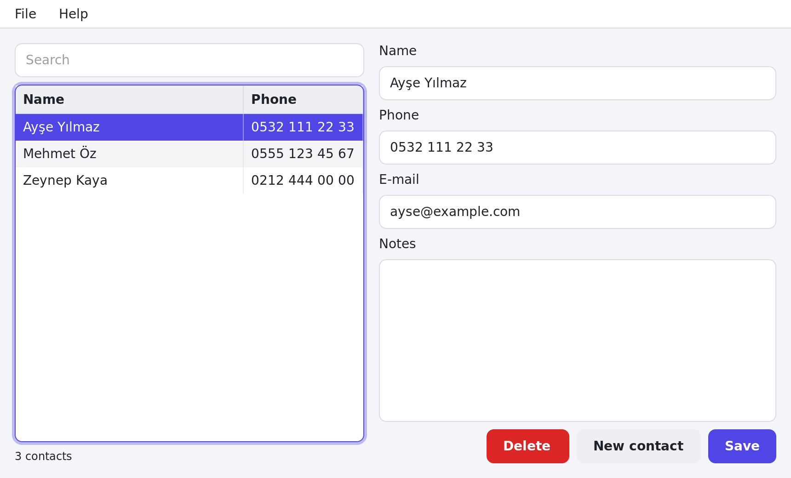

# Announcing Pastel 1.0

*A draft for the release announcement (blog, forums, Free Pascal and Lazarus communities, Hacker News). Fill in the links when the repository is public.*

---

**Pastel 1.0 is out: a free, Delphi-like way to build programs in Object Pascal, with VS Code and Free Pascal.**

Many of us learned programming with Delphi: draw a form, double-click a button, write the code, press F9. Pastel brings that way of working to today's tools — and to more than desktop apps.

## What you can build

- **Desktop apps for Linux and Windows.** Forms live in readable `.pform` files that you design in VS Code: drag controls in, set properties, double-click an event to write its code. About 30 controls (grids, trees, menus, dialogs, tabs...), data binding, translations, themes and dark mode, sharp on high-DPI screens. Save the form while the app runs and the window updates at once.
- **Web APIs and Linux services.** Routes, JSON, validation, API keys and JWT, rate limits, SQLite/PostgreSQL/MySQL with migrations, background jobs, systemd, `.deb` and Docker packages.
- **Command-line tools.** Arguments with automatic help, colors and tables, settings, logging, HTTP, tests.



## What it feels like

```sh
pastel new app contacts
cd contacts
pastel run
```

```pascal
procedure THomeForm.SaveClick(Sender: TObject);
begin
  FStore.SaveJson(ContactData.ToJson);
  ShowMessage('Saved.');
end;
```

VS Code knows your code and the framework: completion, hover, go to definition, rename, compiler errors while you type, a test explorer, F5 debugging.

When the app is ready: `pastel package installer --target windows` makes a Windows installer, `pastel package appimage` and `pastel package deb` Linux packages — all from one Linux machine.

## Fast and small

A console program starts in a millisecond; a desktop app is under a megabyte and draws its first frame in 30 ms; a web service uses a few megabytes of memory and answers thousands of requests per second. Pastel programs are native code compiled by [Free Pascal](https://www.freepascal.org/).

## Stable

1.0 means the framework API, the project file, the form format and the commands stay compatible for all of 1.x. Projects from earlier versions come along with `pastel upgrade`.

## Get it

- Linux: `curl -fsSL https://github.com/azrov/pastel/releases/latest/download/install.sh | sh`
- Windows: the `.zip` from the release page
- VS Code: search for **Pastel** in the extensions
- Docs and guides: the project website; start with *Getting started*

Pastel is MIT-licensed and made in the open. Bug reports, ideas and contributions are very welcome — see CONTRIBUTING.md.
