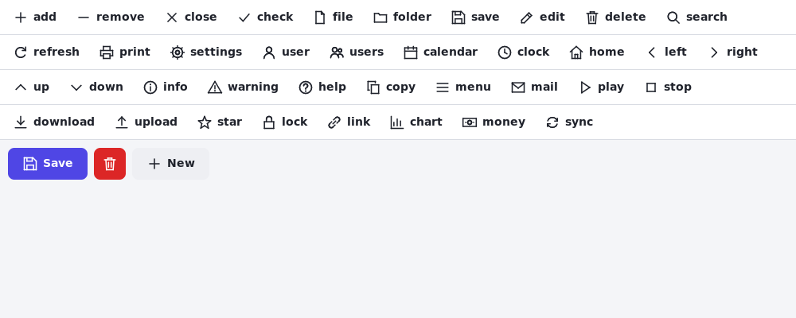

# Controls reference

Every control and component of Pastel, each with an example for the `.pform` file and for the code. Properties that every control has (`Width`, `Height`, `Grow`, `Visible`, `Enabled`, `Hint`, `PopupMenu`) are explained once, under [Common properties](#common-properties). How forms work in general: [forms.md](forms.md); a whole app step by step: [guide-desktop.md](guide-desktop.md); writing controls of your own: [components.md](components.md).

**Layout:** [TColumn](#tcolumn) · [TRow](#trow) · [TCard](#tcard) · [TScrollBox](#tscrollbox) · [TTabControl](#ttabcontrol) · [TTabSheet](#ttabsheet) · [TSpacer](#tspacer) · [TSplitter](#tsplitter) · [TToolBar](#ttoolbar) · [TStatusBar](#tstatusbar)
**Text:** [TLabel](#tlabel) · [TEdit](#tedit) · [TMemo](#tmemo)
**Dates, numbers and money:** [TDatePicker](#tdatepicker) · [TCalendarView](#tcalendarview) · [TTimeEdit](#ttimeedit) · [TNumberEdit](#tnumberedit) · [TCurrencyEdit](#tcurrencyedit)
**Choices:** [TButton](#tbutton) · [TCheckBox](#tcheckbox) · [TSwitch](#tswitch) · [TRadioButton](#tradiobutton) · [TComboBox](#tcombobox) · [TListBox](#tlistbox) · [TSlider](#tslider)
**Tables and trees:** [TGrid](#tgrid) · [TGridColumn](#tgridcolumn) · [TListView](#tlistview) · [TTreeView](#ttreeview)
**Pictures and progress:** [TImage](#timage) · [TProgressBar](#tprogressbar) · [TSpinner](#tspinner)
**Menus:** [TMenuBar](#tmenubar) · [TMenuItem](#tmenuitem) · [TPopupMenu](#tpopupmenu)
**Icons:** [the built-in icons, your own](#icons)
**Without a place on the form:** [TAction](#taction) · [TTimer](#ttimer) · [TDataBinding](#tdatabinding)

## Common properties

| Property | | Example |
|---|---|---|
| `Width`, `Height` | Fixed size in pixels; `0` (the default) is as big as the content | `Width = 200` |
| `Grow` | Takes the free space of its row or column; `2` takes twice as much as `1` | `Grow = 1` |
| `Visible` | `False` hides it and gives its space to the others | `Visible = False` |
| `Enabled` | `False` makes it grey and ignores clicks and keys | `Enabled = False` |
| `Hint` | A tooltip when the mouse rests on it | `Hint = 'Saves the file'` |
| `PopupMenu` | A [TPopupMenu](#tpopupmenu) shown on a right click | `PopupMenu = EditMenu` |

From code, every control has `SetFocus`, `Invalidate` (paint again) and `Bounds` (its place in the window).

## Layout

### TColumn

Puts its children below each other. The form itself is a column.

```
object Fields: TColumn
  Gap = 8
  Padding = 12
  object NameEdit: TEdit
  end
  object EmailEdit: TEdit
  end
end
```

| Property | |
|---|---|
| `Gap` | Space between the children |
| `Padding` | Space inside the edges |
| `Align` | Across the column: `Stretch` (default: as wide as the column), `Start`, `Center`, `End` |
| `Justify` | Along the column: `Start` (default), `Center`, `End`, `SpaceBetween` |
| `Color`, `BorderColor`, `BorderWidth`, `Radius` | Background, border and rounded corners (`Color = '#F3F4F8'`) |

### TRow

Puts its children next to each other. Like [TColumn](#tcolumn), but `Align` is `Center` by default; use `Align = Stretch` to give the children the full height (for two columns side by side).

```
object Buttons: TRow
  Gap = 8
  Justify = End            // to the right
  object CancelButton: TButton
    Text = 'Cancel'
    Style = Secondary
  end
  object SaveButton: TButton
    Text = 'Save'
  end
end
```

### TCard

A column with a background, a border and rounded corners: a box around things that belong together. Same properties as [TColumn](#tcolumn).

```
object LoginCard: TCard
  Width = 360
  object UserEdit: TEdit
    Placeholder = 'User name'
  end
end
```

### TScrollBox

A column that scrolls when its content is taller than it is: mouse wheel, scroll bar, and the focus moving into a hidden control scrolls to it.

```
object Settings: TScrollBox
  Grow = 1
  Gap = 8
  // many controls...
end
```

### TTabControl

Pages with tabs; its children are [TTabSheet](#ttabsheet)s. When the tabs have the focus, Left and Right change the page.

```
object Pages: TTabControl
  Grow = 1
  OnChange = PagesChange
  object GeneralPage: TTabSheet
    Caption = 'General'
  end
  object AdvancedPage: TTabSheet
    Caption = 'Advanced'
  end
end
```

```pascal
Pages.TabIndex := 1;                       // show the second page
if Pages.ActiveSheet = AdvancedPage then ...
```

| | |
|---|---|
| `TabIndex` | The page shown (0 = the first) |
| `OnChange` | Another page was chosen |

### TTabSheet

One page of a [TTabControl](#ttabcontrol): `Caption` is the text of its tab; otherwise a [TColumn](#tcolumn).

### TSpacer

Empty space that takes what is free (`Grow = 1`): pushes the controls after it to the end of a row.

```
object StatusBar: TStatusBar
  object StatusLabel: TLabel
  end
  object Space: TSpacer
  end
  object CountLabel: TLabel          // at the right edge
  end
end
```

### TSplitter

A bar between two controls of a row (or a column) that the user drags to share the room between them; the mouse pointer becomes ↔ (↕ in a column). It changes the `Width` (`Height`) of the control **before** it, so give that one a `Width`, and the one after it `Grow = 1`.

```
object Body: TRow
  Grow = 1
  Align = Stretch
  object Side: TColumn
    Width = 380
    ...
  end
  object SideSplitter: TSplitter
    MinSize = 240          // neither side gets smaller
    OnMoved = SplitterMoved
  end
  object Details: TColumn
    Grow = 1
    ...
  end
end
```

```pascal
procedure THomeForm.SplitterMoved(Sender: TObject);
begin
  StatusBar.Text := Format('%d pixels', [Side.Width]);
end;

SideSplitter.MoveTo(300);               // from code
```

`MinSize` (default 80), `Target` (the control it resizes), `MoveTo(Size)`, `OnMoved`. In a UI script: `drag SideSplitter 40 0`. Example: [`examples/contacts`](../examples/contacts/README.md).

### TToolBar

A row of buttons under the menu. Put `TButton`s with `Style = Flat` in it (no background until the mouse is on them), and a [TSpacer](#tspacer) to push the rest to the right. The form usually has `Padding = 0`, so the bar goes from edge to edge; put the rest of the form in a `TColumn` with its own `Padding`.

```
object Tools: TToolBar
  object NewButton: TButton
    Text = 'New'
    Style = Flat
    Hint = 'Ctrl+N'
    Action = NewAction       // the same command as the menu item
  end
  object SaveButton: TButton
    Text = 'Save'
    Style = Flat
    OnClick = SaveClick
  end
end
```

A [TRow](#trow) with `Padding = 6`, `Gap = 4`, a background and a line under it. Example: [`examples/notepad`](../examples/notepad/README.md).

### TStatusBar

A line at the bottom of the form that says what is going on: its `Text`, or the labels in it.

```
object StatusBar: TStatusBar
  Text = 'Ready'
end
```

```pascal
StatusBar.Text := Format(_('%d contacts'), [Count]);
```

With more than one part, put labels in it (`Text` is then not shown):

```
object StatusBar: TStatusBar
  object StatusLabel: TLabel
    Text = 'new file'
    FontSize = 12
  end
  object Space: TSpacer
  end
  object CountLabel: TLabel
    FontSize = 12
  end
end
```

A [TRow](#trow) with `Padding = 6`, `Gap = 16`, a background and a line over it.

## Text

### TLabel

Text to read. Line breaks in the text (`#10` in code) start new lines; `WordWrap` breaks long lines at the width.

```
object Title: TLabel
  Text = 'Orders'
  FontSize = 22
  Bold = True
  Color = '#4F46E5'
end
```

```pascal
Title.Text := Format('%d orders', [Count]);
```

| | |
|---|---|
| `Text`, `FontSize` (14), `Bold`, `Color` | |
| `TextAlign` | `Left`, `Center`, `Right` |
| `WordWrap` | Break long lines |

### TEdit

One line of text to type.

```
object EmailEdit: TEdit
  Placeholder = 'name@example.com'
  MaxLength = 120
  OnChange = EmailChange
  OnSubmit = SaveClick       // Enter
end
```

```pascal
if Pos('@', EmailEdit.Text) = 0 then
  EmailEdit.SetFocus;
EmailEdit.SelectAll;
```

| | |
|---|---|
| `Text`, `Placeholder` | The text; the grey text shown when it is empty |
| `Password` | Shows dots |
| `ReadOnly`, `MaxLength` | |
| `OnChange` | The text changed (typing or code) |
| `OnSubmit` | Enter was pressed |

From code: `SelectAll`, `SelStart`, `SelLength`, `SelText`, `CopyToClipboard`, `CutToClipboard`, `PasteFromClipboard`, `Undo`, `Redo`. Keys: the usual ones of text fields, with `Ctrl+Z`/`Ctrl+Y` and words with `Ctrl+Left/Right`.

### TMemo

Several lines of text; scrolls; `WordWrap` breaks long lines.

```
object NotesMemo: TMemo
  Grow = 1
  WordWrap = True
  Placeholder = 'Notes'
end
```

```pascal
NotesMemo.Lines.Add('Called on ' + DateToStr(Date));
Count := NotesMemo.Lines.Count;
```

Same properties as [TEdit](#tedit) (without `Password` and `OnSubmit`), plus `Lines` (a `TStrings`) and `WordWrap`.

## Dates, numbers and money

These are in the unit `Pastel.Inputs`. In a `.pform` you write nothing extra; in code that calls its routines (`FormatMoney`, `TryParseMoney`, `TryIsoToDate`, `ParseTimeOfDay`) add `Pastel.Inputs` to `uses`.

### TDatePicker

A date, chosen from a calendar that opens under it. Keys: Enter, Space or Alt+Down opens it; arrows move by days and weeks, Page Up/Down by months, Enter chooses, Escape closes, Delete empties it. The date is shown the way the [language](forms.md) writes dates.

```
object DueDate: TDatePicker
  DateText = '2026-11-01'      // '' = no date
  Placeholder = 'Due date'
  OnChange = DueDateChange
end
```

```pascal
DueDate.Date := Date + 14;
if DueDate.HasDate then
  Order.Put('due', DueDate.DateText);    // '2026-11-15'
DueDate.Clear;
```

| | |
|---|---|
| `Date` | A `TDateTime` without time; `0` when there is none |
| `DateText` | The date as `'2026-11-01'`, `''` for none — for `.pform` files, [`TDataBinding`](#tdatabinding) and UI scripts (`set DueDate.DateText 2026-11-03`) |
| `Placeholder` | Shown when there is no date |
| `OnChange` | The date changed |

From code: `HasDate`, `Clear`, `DropDown`, `CloseUp`, `DroppedDown`. Helpers: `TryIsoToDate('2026-11-01', D)`, `DateToIso(D)`, `MonthTitle(2026, 11)` (*November 2026* in the language).

### TCalendarView

The month grid that `TDatePicker` opens. Put it on a form when the calendar should always be visible (an agenda, a booking page).

```
object Month: TCalendarView
  OnPick = MonthPick
end
```

```pascal
procedure THomeForm.MonthPick(Sender: TObject);
begin
  LoadDay(Month.Selected);
end;

Month.ShowDate(Date);       // this month, today chosen
Month.NextMonth;
```

`Selected` (the chosen day), `Year`, `Month`, `ShowDate`, `NextMonth`, `PreviousMonth`, `OnPick` (a click or Enter on a day). Weeks start on Monday.

### TTimeEdit

A time of day as `HH:MM`. Up/Down (and the mouse wheel) move it by `Step` minutes; `930`, `9.30` or `9` become `09:30`, `09:30`, `09:00` when the field is left.

```
object StartTime: TTimeEdit
  Text = '09:00'
  Step = 30
end
```

```pascal
if not StartTime.HasTime then
  ShowMessage('When does it start?');
Start := DueDate.Date + StartTime.Time;     // a TDateTime with the time
StartTime.Minutes := 14 * 60;              // 14:00
```

`Minutes` (since midnight, `-1` without a time), `Time` (a `TDateTime` fraction), `HasTime`, `Step`; everything of [TEdit](#tedit).

### TNumberEdit

A whole number, with ▲▼ at its right edge. Only digits can be typed; Up/Down, the wheel and the arrows change it by `Step` (Page Up/Down by ten steps); leaving the field puts it between `Min` and `Max`.

```
object QuantityEdit: TNumberEdit
  Min = 1
  Max = 99
  Value = 1
  OnChange = QuantityChange
end
```

```pascal
Total := QuantityEdit.Value * PriceEdit.Value;
QuantityEdit.StepBy(1);
```

`Value`, `Min`, `Max`, `Step`, `StepBy(Count)`; everything of [TEdit](#tedit).

### TCurrencyEdit

An amount of money: what people type (`1.234,50` or `1,234.50`, in the language's way) becomes a `Currency`; leaving the field writes it nicely. `Valid` tells whether the text is an amount.

```
object PriceEdit: TCurrencyEdit
  Symbol = '₺'
  Decimals = 2
  OnChange = PriceChange
end
```

```pascal
if not PriceEdit.Valid then
  Exit;
Cents := Round(PriceEdit.Value * 100);
PriceEdit.Value := 1250.5;              // shows 1,250.50 ₺
TotalLabel.Text := FormatMoney(Total, 2, '₺');
```

`Value`, `Valid`, `Symbol`, `Decimals`; everything of [TEdit](#tedit). Helpers: `TryParseMoney(Text, V)`, `FormatMoney(V, Decimals, Symbol)`.

## Choices

### TButton

```
object SaveButton: TButton
  Text = 'Save'
  Style = Primary          // Primary (default), Secondary, Danger, Flat (for tool bars)
  OnClick = SaveClick
end
```

```pascal
procedure THomeForm.SaveClick(Sender: TObject);
begin
  ...
end;
```

| | |
|---|---|
| `Text`, `Style` | |
| `Icon` | A built-in [icon](#icons) before the text (`Icon = 'save'`), or alone when `Text` is empty — then give it a `Hint` |
| `Action` | A [TAction](#taction): its caption, shortcut and `Enabled` are used |
| `Default` | Enter presses it (in a dialog or form) |
| `Cancel` | Escape presses it |
| `ModalResult` | In a dialog: a click closes it with this result (`mrOk`, `mrCancel`) |
| `OnClick` | |

### TCheckBox

```
object AgreeCheck: TCheckBox
  Text = 'I agree to the terms'
  OnChange = AgreeChange
end
```

```pascal
SendButton.Enabled := AgreeCheck.Checked;
```

`Text`, `Checked`, `OnChange`. Space toggles it.

### TSwitch

An on/off switch; the same as [TCheckBox](#tcheckbox) with another look, for settings that apply at once.

```
object DarkSwitch: TSwitch
  Text = 'Dark mode'
  OnChange = DarkChange
end
```

```pascal
if DarkSwitch.Checked then Appearance := tmDark else Appearance := tmLight;
```

### TRadioButton

One choice of several: the radio buttons with the same parent form a group.

```
object SizeRow: TRow
  object SmallRadio: TRadioButton
    Text = 'Small'
    Checked = True
  end
  object LargeRadio: TRadioButton
    Text = 'Large'
  end
end
```

```pascal
if LargeRadio.Checked then ...
```

### TComboBox

A drop-down list to choose one item.

```
object CityCombo: TComboBox
  Items = ('Ankara', 'İstanbul', 'İzmir')
  Placeholder = 'Choose a city'
  OnChange = CityChange
end
```

```pascal
CityCombo.Items.Add('Bursa');
City := CityCombo.Text;              // the chosen item, '' for none
CityCombo.ItemIndex := 0;            // choose the first
```

| | |
|---|---|
| `Items`, `ItemIndex` (-1 = none), `Text` (the chosen item; setting it chooses it), `Placeholder` | |
| `OnChange` | Another item was chosen |

Keys: Alt+Down or Space opens it, arrows choose, typing a letter jumps.

### TListBox

A list of texts; only the visible rows are drawn, so many thousands are fine.

```
object FileList: TListBox
  Grow = 1
  OnChange = FileListChange
  OnDblClick = FileListOpen     // also Enter
end
```

```pascal
FileList.Items.Assign(ListFiles(Folder, '*.txt'));
if FileList.ItemIndex >= 0 then
  Open(FileList.SelectedText);
```

`Items`, `ItemIndex`, `ItemHeight` (0 = from the font), `OnChange`, `OnDblClick`; `SelectedText` and `MakeVisible(Index)` from code. For rows with several columns use [TListView](#tlistview).

### TSlider

A number chosen by dragging.

```
object VolumeSlider: TSlider
  Min = 0
  Max = 100
  Step = 5
  Position = 50
  OnChange = VolumeChange
end
```

```pascal
VolumeLabel.Text := IntToStr(VolumeSlider.Position) + ' %';
```

Arrows move by `Step`, Home and End go to the ends.

## Tables and trees

### TGrid

A table with columns ([TGridColumn](#tgridcolumn) children). Sorts by a click on a column title; with `Editable = True`, cells can be edited (F2, Enter, a double click or typing). Only the visible rows are drawn.

```
object Products: TGrid
  Grow = 1
  Editable = True
  OnCellEdit = ProductsCellEdit
  object NameColumn: TGridColumn
    Title = 'Product'
    Field = 'name'
  end
  object PriceColumn: TGridColumn
    Title = 'Price'
    Field = 'price'
    Width = 100
    Alignment = Right
  end
end
```

```pascal
Products.LoadJson(Db.Query('select name, price from products', []));   // columns by Field
Products.AddRow(['Tea', '45,00']);
Products.Cells[1, 0] := '50,00';         // column 1, row 0
Products.SortBy(1, True);                // by price, largest first
Rows := Products.ToJson;                 // back to JSON objects

procedure THomeForm.ProductsCellEdit(Sender: TObject; ACol, ARow: Integer;
  var Value: string; var Accept: Boolean);
begin
  if (ACol = 1) and not TryParseNumber(Value, Price) then
    Accept := False;                     // stays in editing
end;
```

| | |
|---|---|
| `Row`, `Col` | The selected row (-1 = none) and column |
| `Editable`, `RowSelect`, `Sortable`, `Striped`, `RowHeight` | |
| `OnChange` | Another row or cell was selected |
| `OnDblClick` | Double click or Enter on a row (when not editing) |
| `OnCellEdit` | A cell was edited: change `Value`, or set `Accept := False` |
| `OnSort` | The rows were sorted |

From code: `AddRow`, `InsertRow`, `DeleteRow`, `Clear`, `RowCount`, `Cells[Col, Row]`, `RowValues[Row]`, `LoadJson`, `ToJson`, `SortBy`, `FindRow(Col, Value)`, `MakeVisible`, `AddColumn`.

### TGridColumn

One column of a [TGrid](#tgrid) or [TListView](#tlistview).

| | |
|---|---|
| `Title` | The text at the top |
| `Field` | The name in `LoadJson` / `ToJson` (a database column); the `Title` when empty |
| `Width` | 0 = shares the free space |
| `Alignment` | `Left`, `Center`, `Right` (numbers) |
| `ReadOnly` | This column is not edited in an editable grid |

### TListView

A [TGrid](#tgrid) for choosing rows: whole rows are selected and nothing is edited. The usual list of records next to a form.

```
object Customers: TListView
  Grow = 1
  OnChange = CustomersChange
  object NameColumn: TGridColumn
    Title = 'Name'
    Field = 'name'
  end
  object CityColumn: TGridColumn
    Title = 'City'
    Field = 'city'
    Width = 120
  end
end
```

```pascal
Rows := Db.Query('select * from customers order by name', []);
Customers.LoadJson(Rows);
if Customers.Row >= 0 then
  CustomerData.Load(Rows.Objects[Customers.Row]);    // TDataBinding
```

### TTreeView

A tree of texts that opens and closes.

```
object Folders: TTreeView
  Items = ('Documents', '  Letters', '  Bills', 'Pictures')   // two spaces per level
  OnChange = FoldersChange
end
```

```pascal
Node := Folders.Add('Music');
Node.AddChild('Jazz').AddChild('Coltrane');
Folders.FullExpand;
Path := Folders.Text;                          // 'Music/Jazz' (the selected node)
Folders.Selected := Folders.FindNode('Documents/Bills');
```

`OnChange` (another node), `OnDblClick` (a leaf node), `OnExpand(Sender, Node)` (a node opened: fill its children late). Keys: arrows, Right opens, Left closes.

## Pictures and progress

### TImage

A picture: PNG, JPEG or BMP.

```
object Logo: TImage
  FileName = 'logo.png'      // assets/logo.png (compiled into release builds)
  Height = 48
  Fit = Contain              // Contain, Cover, Stretch, Center
end
```

```pascal
Photo.FileName := '/home/ali/photo.jpg';
if Photo.LoadError <> '' then ShowMessage(Photo.LoadError);
Photo.LoadFromStream(Stream);              // e.g. downloaded
```

### TProgressBar

```
object Progress: TProgressBar
  Max = 100
  Position = 30
end
```

```pascal
Progress.Position := Done * 100 div Total;
Progress.Indeterminate := True;            // moving: "working, no idea how long"
```

### TSpinner

A small turning circle: "please wait".

```
object Busy: TSpinner
  Active = False
end
```

```pascal
Busy.Active := True;     // while loading
```

## Menus

### TMenuBar

The window's menu bar; its [TMenuItem](#tmenuitem)s are the menus. Put it first in the form. F10 or Alt opens it.

```
object MainMenu: TMenuBar
  object FileMenu: TMenuItem
    Caption = 'File'
    object OpenItem: TMenuItem
      Caption = 'Open...'
      ShortCut = 'Ctrl+O'
      OnClick = OpenClick
    end
    object Sep1: TMenuItem
      Caption = '-'
    end
    object QuitItem: TMenuItem
      Caption = 'Quit'
      ShortCut = 'Ctrl+Q'
      OnClick = QuitClick
    end
  end
end
```

### TMenuItem

| | |
|---|---|
| `Caption` | The text; `'-'` is a separator line |
| `ShortCut` | `'Ctrl+S'`, `'Ctrl+Shift+S'`, `'F5'`, `'Alt+Enter'`; works in the whole window |
| `Checked` | A check mark (toggle it in `OnClick`) |
| `Action` | A [TAction](#taction) gives caption, shortcut, `Enabled` and `Checked` |
| `OnClick` | |

Menu items inside a menu item are a submenu.

### TPopupMenu

A menu that opens on a right click (or the Menu key, or Shift+F10) on the controls that name it in `PopupMenu`.

```
object EditMenu: TPopupMenu
  object CopyItem: TMenuItem
    Caption = 'Copy'
    OnClick = CopyClick
  end
end
object NotesMemo: TMemo
  PopupMenu = EditMenu
end
```

## Icons

Buttons can show an icon: a small line drawing, sharp at every size and in the color of the button's text (so it is right in the dark theme too). The designer offers the names in the `Icon` field.

```
object SaveButton: TButton
  Icon = 'save'
  Text = 'Save'
end
object DeleteButton: TButton
  Icon = 'delete'            // an icon alone: a small square button
  Style = Danger
  Hint = 'Delete the contact'
end
```



`add` `remove` `close` `check` `file` `folder` `save` `edit` `delete` `search` `refresh` `print` `settings` `user` `users` `calendar` `clock` `home` `left` `right` `up` `down` `info` `warning` `help` `copy` `menu` `mail` `play` `stop` `download` `upload` `star` `lock` `link` `chart` `money` `sync`

Your own icons are drawn on a 24 × 24 grid with four commands, the parts separated by `;` — `l x1 y1 x2 y2 ...` (lines through the points), `o cx cy r` (a circle), `f cx cy r` (a dot), `a cx cy r from to` (an arc; degrees, 0 = right, 90 = down). Register them once, for example in the `initialization` of a unit, and use them like the built-in ones:

```pascal
uses
  Pastel.Icons;

initialization
  RegisterIcon('bell', 'l 6 17 6 10; a 12 10 6 180 360; l 18 10 18 17; l 4 17 20 17; f 12 20 1.5');
```

From code: `HasIcon(Name)`, `IconNames`, and `DrawIcon(Canvas, Name, X, Y, Size, Color)` in a control of your own ([components.md](components.md)).

## Without a place on the form

These components are not drawn: they appear at the top of the `.pform` file. In the designer's toolbox they are marked with ◇.

### TAction

One command for a menu item, a button and a shortcut together: they share the caption, and `Enabled := False` disables all of them.

```
object DeleteAction: TAction
  Caption = 'Delete'
  ShortCut = 'Ctrl+D'
  OnExecute = DeleteExecute
end
object DeleteItem: TMenuItem          // inside a menu
  Action = DeleteAction
end
object DeleteButton: TButton
  Action = DeleteAction
  Style = Danger
end
```

```pascal
DeleteAction.Enabled := Customers.Row >= 0;
```

### TTimer

Runs `OnTimer` again and again, every `Interval` milliseconds, on the window's thread (it may change controls).

```
object Clock: TTimer
  Interval = 1000
  OnTimer = ClockTimer
end
```

```pascal
procedure THomeForm.ClockTimer(Sender: TObject);
begin
  TimeLabel.Text := FormatDateTime('hh:nn:ss', Now);
end;

Clock.Enabled := False;      // stop it
```

### TDataBinding

Fills controls from a record (a JSON object, an object's properties or a grid row) and reads them back; see [guide-desktop.md](guide-desktop.md#tables-and-data-binding).

```
object CustomerData: TDataBinding
  Fields = ('NameEdit', 'EmailEdit', 'ActiveSwitch', 'CitySelect=city_name')
end
```

```pascal
CustomerData.Load(Db.QueryOne('select * from customers where id = ?', [Id]));
Data := CustomerData.ToJson;           // {"name": ..., "email": ..., "active": ..., "city_name": ...}
if CustomerData.Modified then ...
CustomerData.Clear;                    // a new record
```

`NameEdit` binds the field `name` (the control's name without its kind, in snake_case); `'CitySelect=city_name'` names the field.
