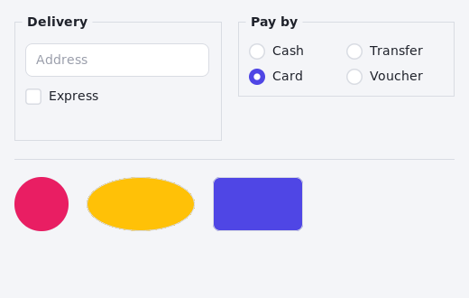
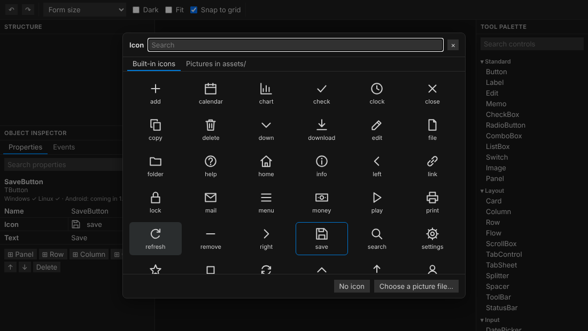
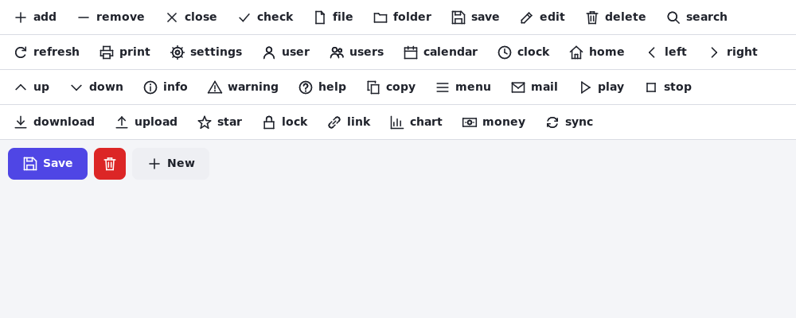

# Controls reference

Every control and component of Pastel, each with an example for the `.pform` file and for the code. Properties that every control has (`Width`, `Height`, `Grow`, `Visible`, `Enabled`, `Hint`, `PopupMenu`) are explained once, under [Common properties](#common-properties). How forms work in general: [forms.md](forms.md); a whole app step by step: [guide-desktop.md](guide-desktop.md); writing controls of your own: [components.md](components.md).

**Layout:** [TPanel](#tpanel) · [TColumn](#tcolumn) · [TRow](#trow) · [TCard](#tcard) · [TScrollBox](#tscrollbox) · [TTabControl](#ttabcontrol) · [TTabSheet](#ttabsheet) · [TSpacer](#tspacer) · [TFlow](#tflow) · [TSplitter](#tsplitter) · [TToolBar](#ttoolbar) · [TStatusBar](#tstatusbar)
**Text:** [TLabel](#tlabel) · [TEdit](#tedit) · [TMemo](#tmemo)
**Dates, numbers and money:** [TDatePicker](#tdatepicker) · [TCalendarView](#tcalendarview) · [TTimeEdit](#ttimeedit) · [TNumberEdit](#tnumberedit) · [TCurrencyEdit](#tcurrencyedit)
**Choices:** [TButton](#tbutton) · [TCheckBox](#tcheckbox) · [TSwitch](#tswitch) · [TRadioButton](#tradiobutton) · [TComboBox](#tcombobox) · [TListBox](#tlistbox) · [TSlider](#tslider)
**Tables and trees:** [TGrid](#tgrid) · [TGridColumn](#tgridcolumn) · [TListView](#tlistview) · [TTreeView](#ttreeview)
**Pictures and progress:** [TImage](#timage) · [TProgressBar](#tprogressbar) · [TSpinner](#tspinner)
**Groups, shapes and drawing:** [TGroupBox](#tgroupbox) · [TRadioGroup](#tradiogroup) · [TShape](#tshape) · [TBevel](#tbevel) · [TPaintBox](#tpaintbox)
**Web pages, video and sound:** [TWebBrowser](#twebbrowser) · [TVideoView](#tvideoview) · [TMediaPlayer](#tmediaplayer) · [TCameraView](#tcameraview)
**Maps and push:** [TMapView](#tmapview) · [TPushNotifications](#tpushnotifications)
**Codes, sensors, the tray:** [TBarcode](#tbarcode) · [TSensor](#tsensor) · [TNfcReader](#tnfcreader) · [TBluetoothLE](#tbluetoothle) · [TTrayIcon](#ttrayicon)
**Menus:** [TMenuBar](#tmenubar) · [TMenuItem](#tmenuitem) · [TPopupMenu](#tpopupmenu)
**Icons:** [the built-in icons, your own](#icons)
**Without a place on the form:** [TAction](#taction) · [TTimer](#ttimer) · [TDataBinding](#tdatabinding) · [TOpenDialog](#topendialog) · [TSaveDialog](#tsavedialog) · [TSelectFolderDialog](#tselectfolderdialog)

## Common properties

| Property | | Example |
|---|---|---|
| `Width`, `Height` | Fixed size in pixels; `0` (the default) is as big as the content | `Width = 200` |
| `Left`, `Top` | The place in a parent with `Layout = Free` ([free placement](forms.md#free-placement)) | `Left = 24` |
| `Anchors` | In a free parent: the edges that follow the parent's when it is resized | `Anchors = [Left, Top, Right]` |
| `Dock` | In a free parent: `Top`, `Bottom`, `Left`, `Right` or `Fill` (Delphi's `Align`) | `Dock = Bottom` |
| `TabOrder` | The Tab key goes through a parent's controls by `TabOrder`; equal ones in their `.pform` order | `TabOrder = 1` |
| `TabStop` | `False`: Tab passes it by (a click still focuses it) | `TabStop = False` |
| `Grow` | Takes the free space of its row or column; `2` takes twice as much as `1` | `Grow = 1` |
| `Visible` | `False` hides it and gives its space to the others | `Visible = False` |
| `Enabled` | `False` makes it grey and ignores clicks and keys | `Enabled = False` |
| `Hint` | A tooltip when the mouse rests on it | `Hint = 'Saves the file'` |
| `PopupMenu` | A [TPopupMenu](#tpopupmenu) shown on a right click | `PopupMenu = EditMenu` |
| `StyleLookup` | A named look of the app's style file: its colors, corners and sizes ([styles](styles.md#looks-stylelookup)) | `StyleLookup = 'BigGreen'` |

From code, every control has `SetFocus`, `Invalidate` (paint again) and `Bounds` (its place in the window).

## Layout

### TPanel

A box whose children stay where they are put, like Delphi's `TPanel` (a container with `Layout = Free`). Give it a `Width` and `Height`; `Color`, `BorderColor`, `BorderWidth`, `Radius` and `BackgroundImage` make it visible.

```
object Details: TPanel
  Left = 16
  Top = 64
  Width = 300
  Height = 160
  Anchors = [Left, Top, Right, Bottom]
  BorderWidth = 1
  BorderColor = '#D0D4DC'
  object CityLabel: TLabel
    Left = 12
    Top = 12
    Text = 'City'
  end
  object CityEdit: TEdit
    Left = 80
    Top = 8
    Width = 208
    Anchors = [Left, Top, Right]
  end
end
```

```pascal
Details.Visible := ShowDetailsCheck.Checked;
```

### TColumn

Puts its children below each other. The form itself is a column.

```
object Fields: TColumn
  Gap = 8
  Padding = 12
  object NameEdit: TEdit
  end
  object EmailEdit: TEdit
  end
end
```

| Property | |
|---|---|
| `Layout` | `Flow` (default): children below each other; `Free`: where their `Left` and `Top` say ([free placement](forms.md#free-placement)) |
| `Gap` | Space between the children |
| `Padding` | Space inside the edges |
| `Align` | Across the column: `Stretch` (default: as wide as the column), `Start`, `Center`, `End` |
| `Justify` | Along the column: `Start` (default), `Center`, `End`, `SpaceBetween` |
| `Color`, `BorderColor`, `BorderWidth`, `Radius` | Background, border and rounded corners (`Color = '#F3F4F8'`) |
| `BackgroundImage` | A picture behind the children: a file in `assets/` (`BackgroundImage = 'paper.png'`), next to the program, or a full path. Rows, cards and the form have it too |
| `BackgroundFit` | `Cover` (default: fills, cut at the edges), `Contain`, `Stretch`, `Center` |

A form with a picture behind it:

```
object LoginForm: TLoginForm
  BackgroundImage = 'login-background.jpg'
  object Box: TCard
    ...
  end
end
```

### TRow

Puts its children next to each other. Like [TColumn](#tcolumn), but `Align` is `Center` by default; use `Align = Stretch` to give the children the full height (for two columns side by side).

```
object Buttons: TRow
  Gap = 8
  Justify = End            // to the right
  object CancelButton: TButton
    Text = 'Cancel'
    Style = Secondary
  end
  object SaveButton: TButton
    Text = 'Save'
  end
end
```

### TCard

A column with a background, a border and rounded corners: a box around things that belong together. Same properties as [TColumn](#tcolumn).

```
object LoginCard: TCard
  Width = 360
  object UserEdit: TEdit
    Placeholder = 'User name'
  end
end
```

### TScrollBox

A column that scrolls when its content is taller than it is: mouse wheel, scroll bar, and the focus moving into a hidden control scrolls to it. `OnRefresh`: pull down to refresh, as on [TListView](#tlistview).

```
object Settings: TScrollBox
  Grow = 1
  Gap = 8
  // many controls...
end
```

### TTabControl

Pages with tabs; its children are [TTabSheet](#ttabsheet)s. When the tabs have the focus, Left and Right change the page.

```
object Pages: TTabControl
  Grow = 1
  OnChange = PagesChange
  object GeneralPage: TTabSheet
    Caption = 'General'
  end
  object AdvancedPage: TTabSheet
    Caption = 'Advanced'
  end
end
```

```pascal
Pages.TabIndex := 1;                       // show the second page
if Pages.ActiveSheet = AdvancedPage then ...
```

| | |
|---|---|
| `TabIndex` | The page shown (0 = the first) |
| `TabPosition` | `tpTop` (a computer's tabs) or `tpBottom`: below the pages, the whole width shared out, an icon above each caption — a phone app's bottom navigation |
| `OnChange` | Another page was chosen |

A phone app's pages, with the tabs at the bottom:

```
object Pages: TTabControl
  Grow = 1
  TabPosition = tpBottom
  object HomePage: TTabSheet
    Caption = 'Home'
    TabIcon = 'home'
  end
  object SearchPage: TTabSheet
    Caption = 'Search'
    TabIcon = 'search'
  end
end
```

### TTabSheet

One page of a [TTabControl](#ttabcontrol): `Caption` is the text of its tab, `TabIcon` its icon (one of
[Pastel's icons](#icons)); otherwise a [TColumn](#tcolumn).

### TDrawer

A panel that slides over the window from its left side (`Side = psRight`: the right one): a phone app's menu,
behind the ☰ button. It holds controls like a column and takes no room on the form until `Open`; a tap beside it or
Back (Escape) closes it, the window dimmed behind it.

```
object MenuButton: TButton
  Icon = 'menu'
  Style = Flat
  OnClick = MenuButtonClick
end
object Menu: TDrawer
  object HomeItem: TButton
    Text = 'Home'
    Style = Flat
    OnClick = HomeItemClick
  end
  object SettingsItem: TButton
    Text = 'Settings'
    Style = Flat
    OnClick = SettingsItemClick
  end
end
```

```pascal
procedure THomeForm.MenuButtonClick(Sender: TObject);
begin
  Menu.Open;                 // Menu.Toggle, Menu.Close, Menu.IsOpen
end;

procedure THomeForm.SettingsItemClick(Sender: TObject);
begin
  Menu.Close;
  SettingsForm.ShowModal(@SettingsClosed);
end;
```

`Width` is its width (300 when not set, at most 85 % of the window); `OnOpen` and `OnClose` say when it opens and
closes.

### TBottomSheet

A [TDrawer](#tdrawer) that comes up from the bottom, as high as its content: choices about something, its details,
a short form.

```
object Actions: TBottomSheet
  object CallItem: TButton
    Text = 'Call'
    Style = Flat
  end
end
```

### TSpacer

Empty space that takes what is free (`Grow = 1`): pushes the controls after it to the end of a row.

```
object StatusBar: TStatusBar
  object StatusLabel: TLabel
  end
  object Space: TSpacer
  end
  object CountLabel: TLabel          // at the right edge
  end
end
```

### TFlow

A row that wraps: the controls are placed left to right and go on in the next line when there is no more room — for tags, chips, a set of buttons, small cards that fill a wide window and stack on a narrow one. `Gap` is the space between them and between the lines; in each line, the ones with `Grow` share what is left.

```
object Services: TFlow
  Gap = 8
  object Cut: TButton
    Text = 'Cut'
    Style = Secondary
  end
  object Color: TButton
    Text = 'Color'
    Style = Secondary
  end
  object Care: TButton
    Text = 'Care'
    Style = Secondary
  end
end
```

```pascal
B := TButton.Create(Self);
B.Text := Name;
B.Parent := Services;          // added at the end; the flow places it
```

`Align` places the controls of a line at its top (`Start`), middle (`Center`, the default) or bottom.

### TSplitter

A bar between two controls of a row (or a column) that the user drags to share the room between them; the mouse pointer becomes ↔ (↕ in a column). It changes the `Width` (`Height`) of the control **before** it, so give that one a `Width`, and the one after it `Grow = 1`.

```
object Body: TRow
  Grow = 1
  Align = Stretch
  object Side: TColumn
    Width = 380
    ...
  end
  object SideSplitter: TSplitter
    MinSize = 240          // neither side gets smaller
    OnMoved = SplitterMoved
  end
  object Details: TColumn
    Grow = 1
    ...
  end
end
```

```pascal
procedure THomeForm.SplitterMoved(Sender: TObject);
begin
  StatusBar.Text := Format('%d pixels', [Side.Width]);
end;

SideSplitter.MoveTo(300);               // from code
```

`MinSize` (default 80), `Target` (the control it resizes), `MoveTo(Size)`, `OnMoved`. In a UI script: `drag SideSplitter 40 0`. Example: [`examples/contacts`](../examples/contacts/README.md).

### TToolBar

A row of buttons under the menu. Put `TButton`s with `Style = Flat` in it (no background until the mouse is on them), and a [TSpacer](#tspacer) to push the rest to the right. The form usually has `Padding = 0`, so the bar goes from edge to edge; put the rest of the form in a `TColumn` with its own `Padding`.

```
object Tools: TToolBar
  object NewButton: TButton
    Text = 'New'
    Style = Flat
    Hint = 'Ctrl+N'
    Action = NewAction       // the same command as the menu item
  end
  object SaveButton: TButton
    Text = 'Save'
    Style = Flat
    OnClick = SaveClick
  end
end
```

A [TRow](#trow) with `Padding = 6`, `Gap = 4`, a background and a line under it. Example: [`examples/notepad`](../examples/notepad/README.md).

### TStatusBar

A line at the bottom of the form that says what is going on: its `Text`, or the labels in it.

```
object StatusBar: TStatusBar
  Text = 'Ready'
end
```

```pascal
StatusBar.Text := Format(_('%d contacts'), [Count]);
```

With more than one part, put labels in it (`Text` is then not shown):

```
object StatusBar: TStatusBar
  object StatusLabel: TLabel
    Text = 'new file'
    FontSize = 12
  end
  object Space: TSpacer
  end
  object CountLabel: TLabel
    FontSize = 12
  end
end
```

A [TRow](#trow) with `Padding = 6`, `Gap = 16`, a background and a line over it.

## Text

### TLabel

Text to read. Line breaks in the text (`#10` in code) start new lines; `WordWrap` breaks long lines at the width.

```
object Title: TLabel
  Text = 'Orders'
  FontSize = 22
  Bold = True
  Color = '#4F46E5'
end
```

```pascal
Title.Text := Format('%d orders', [Count]);
```

| | |
|---|---|
| `Text`, `FontSize` (14), `Bold`, `Color` | |
| `TextAlign` | `Left`, `Center`, `Right` |
| `WordWrap` | Break long lines |

### TEdit

One line of text to type.

```
object EmailEdit: TEdit
  Placeholder = 'name@example.com'
  MaxLength = 120
  OnChange = EmailChange
  OnSubmit = SaveClick       // Enter
end
```

```pascal
if Pos('@', EmailEdit.Text) = 0 then
  EmailEdit.SetFocus;
EmailEdit.SelectAll;
```

| | |
|---|---|
| `Text`, `Placeholder` | The text; the grey text shown when it is empty |
| `Password` | Shows dots |
| `ReadOnly`, `MaxLength` | |
| `KeyboardType` | The phone's on-screen keyboard: `ktText`, `ktNumber`, `ktDecimal`, `ktPhone`, `ktEmail`, `ktUrl`, `ktTime`; `ktDefault` lets the edit choose (`TNumberEdit`: numbers, `TCurrencyEdit`: with a decimal point, `TTimeEdit`: a time) |
| `ReturnKeyType` | What the on-screen keyboard's Enter key says: `rkDone` (the default), `rkGo`, `rkNext` (to the next control), `rkSearch`, `rkSend`; the others call `OnSubmit` |
| `OnChange` | The text changed (typing or code) |
| `OnSubmit` | Enter was pressed |

On a phone ([android.md](android.md)):

```
object PhoneEdit: TEdit
  Placeholder = 'Phone'
  KeyboardType = ktPhone
  ReturnKeyType = rkNext
end
object AgeEdit: TNumberEdit        // numbers by itself
  ReturnKeyType = rkDone
end
```

A right click (on a phone: a finger held on the text, which selects the word there) shows Cut, Copy, Paste and Select all, in the app's language; a `PopupMenu` of your own replaces them. From code: `SelectAll`, `SelStart`, `SelLength`, `SelText`, `CopyToClipboard`, `CutToClipboard`, `PasteFromClipboard`, `Undo`, `Redo`. Keys: the usual ones of text fields, with `Ctrl+Z`/`Ctrl+Y` and words with `Ctrl+Left/Right`.

### TMemo

Several lines of text; scrolls; `WordWrap` breaks long lines.

```
object NotesMemo: TMemo
  Grow = 1
  WordWrap = True
  Placeholder = 'Notes'
end
```

```pascal
NotesMemo.Lines.Add('Called on ' + DateToStr(Date));
Count := NotesMemo.Lines.Count;
```

Same properties as [TEdit](#tedit) (without `Password` and `OnSubmit`), plus `Lines` (a `TStrings`) and `WordWrap`.

#### Code: colors and words offered while typing

A memo can be a small code editor. `OnHighlight` colors its text; `Pastel.Syntax` has the highlighters of SQL,
Pascal and JSON (the colors follow the light or dark theme: `SyntaxColor`):

```pascal
uses Pastel.Syntax;

SqlMemo.OnHighlight := @Syntax.Sql;            // or Syntax.Pascal, Syntax.Json
for K in SqlKeywords do
  SqlMemo.Completions.Add(LowerCase(K));       // words offered while typing
SqlMemo.Completions.Add('customers');
```

`Completions` (TEdit has it too) shows a list under the caret as a word is typed: Up and Down choose, Enter or
Tab put the word in, Escape closes it, Ctrl+Space shows it at any time. `OnCompletions` gives the words when
they depend on what is typed: after `orders.` the columns of `orders`:

```pascal
procedure TMainForm.SqlCompletions(Sender: TObject; const Word: string; Items: TStrings);
begin
  if SameText(Word, 'orders.') or Word.StartsWith('orders.', True) then
  begin
    Items.Clear;                    // only the columns here
    Items.AddStrings(['id', 'customer_id', 'total']);
  end;
end;
```

A highlighter of another language: `HighlightCode` with a `TCodeLanguage` (its keywords, comments and quotes),
called from a handler of your own: `Spans := HighlightCode(MyLanguage, AText)`. `RehighlightText` colors the
text again when what the colors depend on changed.

## Dates, numbers and money

These are in the unit `Pastel.Inputs`. In a `.pform` you write nothing extra; in code that calls its routines (`FormatMoney`, `TryParseMoney`, `TryIsoToDate`, `ParseTimeOfDay`) add `Pastel.Inputs` to `uses`.

### TDatePicker

A date, chosen from a calendar that opens under it. Keys: Enter, Space or Alt+Down opens it; arrows move by days and weeks, Page Up/Down by months, Enter chooses, Escape closes, Delete empties it. The date is shown the way the [language](forms.md) writes dates.

```
object DueDate: TDatePicker
  DateText = '2026-11-01'      // '' = no date
  Placeholder = 'Due date'
  OnChange = DueDateChange
end
```

```pascal
DueDate.Date := Date + 14;
if DueDate.HasDate then
  Order.Put('due', DueDate.DateText);    // '2026-11-15'
DueDate.Clear;
```

| | |
|---|---|
| `Date` | A `TDateTime` without time; `0` when there is none |
| `DateText` | The date as `'2026-11-01'`, `''` for none — for `.pform` files, [`TDataBinding`](#tdatabinding) and UI scripts (`set DueDate.DateText 2026-11-03`) |
| `Placeholder` | Shown when there is no date |
| `NativePicker` | On a phone, the phone's own date picker instead of Pastel's calendar (default `True`) |
| `OnChange` | The date changed |

From code: `HasDate`, `Clear`, `DropDown`, `CloseUp`, `DroppedDown`. Helpers: `TryIsoToDate('2026-11-01', D)`, `DateToIso(D)`, `MonthTitle(2026, 11)` (*November 2026* in the language).

### TCalendarView

The month grid that `TDatePicker` opens. Put it on a form when the calendar should always be visible (an agenda, a booking page).

```
object Month: TCalendarView
  OnPick = MonthPick
end
```

```pascal
procedure THomeForm.MonthPick(Sender: TObject);
begin
  LoadDay(Month.Selected);
end;

Month.ShowDate(Date);       // this month, today chosen
Month.NextMonth;
```

`Selected` (the chosen day), `Year`, `Month`, `ShowDate`, `NextMonth`, `PreviousMonth`, `OnPick` (a click or Enter on a day). Weeks start on Monday.

### TTimeEdit

A time of day as `HH:MM`. Up/Down (and the mouse wheel) move it by `Step` minutes; `930`, `9.30` or `9` become `09:30`, `09:30`, `09:00` when the field is left. On a phone a tap opens the phone's own time picker instead of the keyboard (`NativePicker = False`: the keyboard); `PickTime` opens it from code.

```
object StartTime: TTimeEdit
  Text = '09:00'
  Step = 30
end
```

```pascal
if not StartTime.HasTime then
  ShowMessage('When does it start?');
Start := DueDate.Date + StartTime.Time;     // a TDateTime with the time
StartTime.Minutes := 14 * 60;              // 14:00
```

`Minutes` (since midnight, `-1` without a time), `Time` (a `TDateTime` fraction), `HasTime`, `Step`; everything of [TEdit](#tedit).

### TMaskEdit

Text in a fixed shape: a phone number, an IBAN, a postcode, a tax number. `EditMask` is like Delphi's: `0` a digit,
`9` a digit or nothing, `L` a letter, `l` a letter or nothing, `A` a letter or digit, `a` the same or nothing, `C`
any character, `c` any or nothing, `>` what follows in capitals, `<` in small letters, `\` the next one as it is;
everything else stays as it is. Typing fills the next place and jumps over the fixed characters; Backspace
empties the one before; a mask of digits brings the phone's number keyboard.

```
object PhoneEdit: TMaskEdit
  EditMask = '(000) 000 00 00'
end
object IbanEdit: TMaskEdit
  EditMask = '>LL00 0000 0000 0000 0000 0000 00;0'
end
```

```pascal
if not PhoneEdit.IsComplete then
  ShowMessage('The phone number is not complete');
Customer.Phone := PhoneEdit.Text;      // '(532) 123 45 67'
Customer.Iban := IbanEdit.Text;        // ';0': without the spaces: 'TR330006100519786457841326'
PhoneEdit.Value := '5321234567';       // the places filled from what was typed
```

After a `;`, `0` leaves the fixed characters out of `Text`; after a second `;` comes the character of the empty
places (`_` when not set). `Value` is what was typed, without them, whatever the mask says.

### TNumberEdit

A whole number, with ▲▼ at its right edge. Only digits can be typed; Up/Down, the wheel and the arrows change it by `Step` (Page Up/Down by ten steps); leaving the field puts it between `Min` and `Max`.

```
object QuantityEdit: TNumberEdit
  Min = 1
  Max = 99
  Value = 1
  OnChange = QuantityChange
end
```

```pascal
Total := QuantityEdit.Value * PriceEdit.Value;
QuantityEdit.StepBy(1);
```

`Value`, `Min`, `Max`, `Step`, `StepBy(Count)`; everything of [TEdit](#tedit).

### TCurrencyEdit

An amount of money: what people type (`1.234,50` or `1,234.50`, in the language's way) becomes a `Currency`; leaving the field writes it nicely. `Valid` tells whether the text is an amount.

```
object PriceEdit: TCurrencyEdit
  Symbol = '₺'
  Decimals = 2
  OnChange = PriceChange
end
```

```pascal
if not PriceEdit.Valid then
  Exit;
Cents := Round(PriceEdit.Value * 100);
PriceEdit.Value := 1250.5;              // shows 1,250.50 ₺
TotalLabel.Text := FormatMoney(Total, 2, '₺');
```

`Value`, `Valid`, `Symbol`, `Decimals`; everything of [TEdit](#tedit). Helpers: `TryParseMoney(Text, V)`, `FormatMoney(V, Decimals, Symbol)`.

## Choices

### TButton

```
object SaveButton: TButton
  Text = 'Save'
  Style = Primary          // Primary (default), Secondary, Danger, Flat (for tool bars)
  OnClick = SaveClick
end

object BuyButton: TButton
  Text = 'Buy'
  Color = '#E91E63'        // any color; hovering and pressing shade it
  TextColor = '#FFFFFF'
end
```

```pascal
procedure THomeForm.SaveClick(Sender: TObject);
begin
  ...
end;
```

| | |
|---|---|
| `Text`, `Style` | |
| `Color`, `TextColor` | Any background and text color instead of the style's (`Color = '#16A34A'`); from code `BuyButton.Color := $FF16A34A` |
| `Icon` | A built-in [icon](#icons) before the text (`Icon = 'save'`), or alone when `Text` is empty — then give it a `Hint` |
| `Action` | A [TAction](#taction): its caption, shortcut and `Enabled` are used |
| `Default` | Enter presses it (in a dialog or form) |
| `Cancel` | Escape presses it |
| `ModalResult` | In a dialog: a click closes it with this result (`mrOk`, `mrCancel`) |
| `OnClick` | |

### TCheckBox

```
object AgreeCheck: TCheckBox
  Text = 'I agree to the terms'
  OnChange = AgreeChange
end
```

```pascal
SendButton.Enabled := AgreeCheck.Checked;
```

`Text`, `Checked`, `OnChange`. Space toggles it.

### TSwitch

An on/off switch; the same as [TCheckBox](#tcheckbox) with another look, for settings that apply at once.

```
object DarkSwitch: TSwitch
  Text = 'Dark mode'
  OnChange = DarkChange
end
```

```pascal
if DarkSwitch.Checked then Appearance := tmDark else Appearance := tmLight;
```

### TRadioButton

One choice of several: the radio buttons with the same parent form a group.

```
object SizeRow: TRow
  object SmallRadio: TRadioButton
    Text = 'Small'
    Checked = True
  end
  object LargeRadio: TRadioButton
    Text = 'Large'
  end
end
```

```pascal
if LargeRadio.Checked then ...
```

### TComboBox

A drop-down list to choose one item.

```
object CityCombo: TComboBox
  Items = ('Ankara', 'İstanbul', 'İzmir')
  Placeholder = 'Choose a city'
  OnChange = CityChange
end
```

```pascal
CityCombo.Items.Add('Bursa');
City := CityCombo.Text;              // the chosen item, '' for none
CityCombo.ItemIndex := 0;            // choose the first
```

| | |
|---|---|
| `Items`, `ItemIndex` (-1 = none), `Text` (the chosen item; setting it chooses it), `Placeholder` | |
| `OnChange` | Another item was chosen |

Keys: Alt+Down or Space opens it, arrows choose, typing a letter jumps.

### TListBox

A list of texts; only the visible rows are drawn, so many thousands are fine.

```
object FileList: TListBox
  Grow = 1
  OnChange = FileListChange
  OnDblClick = FileListOpen     // also Enter
end
```

```pascal
FileList.Items.Assign(ListFiles(Folder, '*.txt'));
if FileList.ItemIndex >= 0 then
  Open(FileList.SelectedText);
```

**Rows moved by the user.** With `AllowReorder = True` each row has a grip (≡) at its right: held there (with the
mouse or a finger) the row follows until let go; `Ctrl+Up` / `Ctrl+Down` move the selected one. `OnReorder` says
from where to where, once `Items` is in the new order — to save the order:

```pascal
procedure THomeForm.StepsReorder(Sender: TObject; FromIndex, ToIndex: Integer);
begin
  Store.MoveStep(FromIndex, ToIndex);
end;
```

[TListView](#tlistview) and [TGrid](#tgrid) have the same (not while filtered; the sort arrow goes, the order is the
user's).

`Items`, `ItemIndex`, `ItemHeight` (0 = from the font), `OnChange`, `OnDblClick`; `SelectedText` and `MakeVisible(Index)` from code. For rows with several columns use [TListView](#tlistview).

### TSlider

A number chosen by dragging.

```
object VolumeSlider: TSlider
  Min = 0
  Max = 100
  Step = 5
  Position = 50
  OnChange = VolumeChange
end
```

```pascal
VolumeLabel.Text := IntToStr(VolumeSlider.Position) + ' %';
```

Arrows move by `Step`, Home and End go to the ends.

## Tables and trees

### TGrid

A table with columns ([TGridColumn](#tgridcolumn) children). Sorts by a click on a column title; with `Editable = True`, cells can be edited (F2, Enter, a double click or typing). Only the visible rows are drawn.

```
object Products: TGrid
  Grow = 1
  Editable = True
  OnCellEdit = ProductsCellEdit
  object NameColumn: TGridColumn
    Title = 'Product'
    Field = 'name'
  end
  object PriceColumn: TGridColumn
    Title = 'Price'
    Field = 'price'
    Width = 100
    Alignment = Right
  end
end
```

```pascal
Products.LoadJson(Db.Query('select name, price from products', []));   // columns by Field
Products.AddRow(['Tea', '45,00']);
Products.Cells[1, 0] := '50,00';         // column 1, row 0
Products.SortBy(1, True);                // by price, largest first
Rows := Products.ToJson;                 // back to JSON objects

procedure THomeForm.ProductsCellEdit(Sender: TObject; ACol, ARow: Integer;
  var Value: string; var Accept: Boolean);
begin
  if (ACol = 1) and not TryParseNumber(Value, Price) then
    Accept := False;                     // stays in editing
end;
```

| | |
|---|---|
| `Row`, `Col` | The selected row (-1 = none) and column |
| `Editable`, `RowSelect`, `Sortable`, `Striped`, `RowHeight` | |
| `OnChange` | Another row or cell was selected |
| `OnDblClick` | Double click or Enter on a row (when not editing) |
| `OnCellEdit` | A cell was edited: change `Value`, or set `Accept := False` |
| `OnSort` | The rows were sorted |

From code: `AddRow`, `InsertRow`, `DeleteRow`, `Clear`, `RowCount`, `Cells[Col, Row]`, `RowValues[Row]`, `LoadJson`, `ToJson`, `SortBy`, `FindRow(Col, Value)`, `MakeVisible`, `AddColumn`, `ToggleCheck(Col, Row)`.

**Numbers, money, dates, check boxes, icons.** A column's `Kind` says what its cells hold. The cell keeps the value as data — `'1380.6'`, `'2026-11-03'`, `'1'` — and the column shows it the way the language writes it (`1.380,60` in Turkish), sorts it as a number or a date, and `ToJson` gives numbers and true/false:

```
object TotalColumn: TGridColumn
  Title = 'Total'
  Field = 'total'
  Kind = Money              // Text, Number, Money, Date, Check, Icon
end
object PaidColumn: TGridColumn
  Title = 'Paid'
  Field = 'paid'
  Kind = Check              // a check box; a click or Space changes it in an Editable grid
end
object StateColumn: TGridColumn
  Field = 'state_icon'
  Kind = Icon               // the cell is an icon's name: 'check', 'warning'...
  Width = 40
end
```

Numbers are typed the language's way (`1.380,6`) and kept as `1380.6`. `Decimals` sets the digits after the point (money: 2).

**Searching.** `Filter(Text)` shows only the rows with the text in a cell (as shown, any case); `Filter('')` shows all again. Row numbers then count the shown rows; changes made meanwhile stay.

```pascal
procedure THomeForm.SearchChange(Sender: TObject);
begin
  Invoices.Filter(Trim(SearchEdit.Text));
end;
```

**To Excel.** `ToCsv(';')` gives the shown rows as CSV with the titles, which Excel opens; for a real `.xlsx`, `TSpreadsheet.AddJson(Grid.ToJson, ...)` ([documents.md](documents.md#excel-and-csv)).

### TGridColumn

One column of a [TGrid](#tgrid) or [TListView](#tlistview).

| | |
|---|---|
| `Title` | The text at the top |
| `Field` | The name in `LoadJson` / `ToJson` (a database column); the `Title` when empty |
| `Width` | 0 = shares the free space |
| `Alignment` | `Left`, `Center`, `Right` (numbers) |
| `Kind` | `Text`, `Number`, `Money`, `Date`, `Check`, `Icon` — how the values are shown and sorted ([TGrid](#tgrid)) |
| `Decimals` | Digits after the point for `Number` and `Money` |
| `ReadOnly` | This column is not edited in an editable grid |

### TListView

A [TGrid](#tgrid) for choosing rows: whole rows are selected and nothing is edited. The usual list of records next to a form.

```
object Customers: TListView
  Grow = 1
  OnChange = CustomersChange
  object NameColumn: TGridColumn
    Title = 'Name'
    Field = 'name'
  end
  object CityColumn: TGridColumn
    Title = 'City'
    Field = 'city'
    Width = 120
  end
end
```

```pascal
Rows := Db.Query('select * from customers order by name', []);
Customers.LoadJson(Rows);
if Customers.Row >= 0 then
  CustomerData.Load(Rows.Objects[Customers.Row]);    // TDataBinding
```

**Pull down to refresh.** With `OnRefresh`, a finger that pulls the list down past its top (on a phone; F5 on a
computer) calls it; a circle turns above the list until `Refreshing := False`:

```pascal
procedure THomeForm.CustomersRefresh(Sender: TObject);
begin
  Sync.Pull;                       // or a request without waiting
  Customers.LoadJson(Db.Query('select * from customers order by name', []));
  Customers.Refreshing := False;
end;
```

### TTreeView

A tree of texts that opens and closes.

```
object Folders: TTreeView
  Items = ('Documents', '  Letters', '  Bills', 'Pictures')   // two spaces per level
  OnChange = FoldersChange
end
```

```pascal
Node := Folders.Add('Music');
Node.AddChild('Jazz').AddChild('Coltrane');
Folders.FullExpand;
Path := Folders.Text;                          // 'Music/Jazz' (the selected node)
Folders.Selected := Folders.FindNode('Documents/Bills');
```

`OnChange` (another node), `OnDblClick` (a leaf node), `OnExpand(Sender, Node)` (a node opened: fill its children late). Keys: arrows, Right opens, Left closes.

### TTileView

Many items with pictures: a grid of tiles (posters, products) or a list of rows (channels with their logos).
Thousands stay quick — only what is on the screen is drawn, and the pictures come from the web as they are seen
(`Pastel.WebImages`: four threads, a cache folder, made smaller on the way).

```
object Movies: TTileView
  Grow = 1
  Style = tsGrid            // or tsList: a row each, the picture at the left
  TileWidth = 160           // tiles grow to fill the row
  ImageRatio = 1.5          // the picture's height / width (posters)
  EmptyText = 'Nothing here.'
  OnItemClick = MoviesItemClick
end
```

```pascal
Movies.Clear;
for M in List do
  Movies.Add(M.Name, M.Year, M.PosterUrl, M.Id);       // title, line under it, picture, Tag
T := Movies.Tiles[Movies.ItemIndex];                    // Title, Subtitle, ImageUrl, Badge, Tag, Data
T.Badge := '★ 7.5';
Movies.SetTile(Movies.ItemIndex, T);
```

The arrows move between the tiles (a TV's remote too); at an edge they go on to the control beside it. Enter
or a click: `OnItemClick`; `OnChange` when another is chosen. A finger or the mouse pulls the tiles, the wheel
scrolls.

## Pictures and progress

### TImage

A picture: PNG, JPEG or BMP.

```
object Logo: TImage
  FileName = 'logo.png'      // assets/logo.png (compiled into release builds)
  Height = 48
  Fit = Contain              // Contain, Cover, Stretch, Center
end
```

```pascal
Photo.FileName := '/home/ali/photo.jpg';
if Photo.LoadError <> '' then ShowMessage(Photo.LoadError);
Photo.LoadFromStream(Stream);              // e.g. downloaded
Poster.Url := 'https://example.com/poster.jpg';   // with Pastel.WebImages in uses
```

`Url`: a picture from the web, fetched on a thread and kept in a cache folder (`Pastel.WebImages`; nothing shows
while it comes). `WebImage(Url)` gives such a picture to code that draws (a `TPaintBox`).

### TProgressBar

```
object Progress: TProgressBar
  Max = 100
  Position = 30
end
```

```pascal
Progress.Position := Done * 100 div Total;
Progress.Indeterminate := True;            // moving: "working, no idea how long"
```

### TSpinner

A small turning circle: "please wait".

```
object Busy: TSpinner
  Active = False
end
```

```pascal
Busy.Active := True;     // while loading
```

## Groups, shapes and drawing

These are in the *Additional* group of the designer's palette, like in Delphi.

### TGroupBox

A frame with a title around controls that belong together. Its controls are placed freely, like in Delphi (start them below the title: `Top = 32`); `Layout = Flow` stacks them under the title instead.

```
object Delivery: TGroupBox
  Left = 16
  Top = 16
  Width = 240
  Height = 140
  Text = 'Delivery'
  object AddressEdit: TEdit
    Left = 12
    Top = 32
    Width = 216
  end
  object ExpressCheck: TCheckBox
    Left = 12
    Top = 80
    Text = 'Express'
  end
end
```

```pascal
Delivery.Enabled := not PickUpCheck.Checked;
```

### TRadioGroup

A framed list of choices; one is chosen at a time. Click an item or use the arrow keys.

```
object PayBy: TRadioGroup
  Text = 'Pay by'
  Items = ('Cash', 'Card', 'Transfer')
  ItemIndex = 0
  Columns = 1                // 2: the items fill two columns
  OnChange = PayByChange
end
```

```pascal
procedure THomeForm.PayByChange(Sender: TObject);
begin
  CardPanel.Visible := PayBy.Value = 'Card';     // or PayBy.ItemIndex = 1
end;
```



### TShape

A rectangle, rounded rectangle, ellipse or circle (the biggest one in its place).

```
object Status: TShape
  Width = 16
  Height = 16
  Shape = Circle             // Rectangle (default), RoundRect, Ellipse, Circle
  Color = '#16A34A'          // the fill; default: the theme's surface
  BorderWidth = 0            // BorderColor, BorderWidth: the outline
end
```

```pascal
if Online then Status.Color := $FF16A34A else Status.Color := $FFDC2626;
```

### TBevel

A thin line across a form (`Kind = Horizontal`, the default), down (`Vertical`), or a frame (`Frame`).

```
object Divider: TBevel
  Left = 16
  Top = 172
  Width = 488
end
```

```pascal
Divider.Visible := DetailsVisible;
```

### TChart

Bars, lines, pies and donuts, drawn by Pastel (the same everywhere), with a legend, the value under the mouse (or
finger) and a click event. The designer shows it with the data of the `.pform`:

```
object Sales: TChart
  Kind = ckBar
  Title = 'Sales'
  Labels = ('Jan', 'Feb', 'Mar')
  Data = ('2025=12,15,9', '2026=14,18,16')
  OnItemClick = SalesItemClick
end
```

```pascal
Sales.Clear;
Sales.SetLabels(['Jan', 'Feb', 'Mar']);
Sales.AddSeries('2026', [14, 18, 16]);
Sales.LoadJson(Db.Query('select month, income, costs from totals', []), 'month', ['income', 'costs']);

procedure THomeForm.SalesItemClick(Sender: TObject; SeriesIndex, ItemIndex: Integer);
begin
  ShowMonth(ItemIndex);
end;
```

| | |
|---|---|
| `Kind` | `ckBar`, `ckLine`, `ckPie`, `ckDonut` (pies and donuts show the first series, a slice a label; a donut its total in the middle) |
| `Labels`, `Data` | The labels; the series as `'Name=1,2,3'` lines (the decimal point a dot) |
| `ShowLegend`, `ShowValues` | The names of the series; the numbers on the bars, points and slices |
| `Stacked` | The bars of the series on each other |
| `ValueFormat` | `Format`'s (`'%.1f'`, `'%.0n'`); empty writes them short (`12.7k`) |

### TPaintBox

A place to draw on yourself. `OnPaint` gets the canvas, clipped to the box; `Bounds` tells where the box is. `Invalidate` draws it again; the mouse events give X and Y inside the box. Without `OnPaint` a thin frame shows where it is.

```
object Chart: TPaintBox
  Width = 300
  Height = 160
  OnPaint = ChartPaint
  OnMouseDown = ChartMouseDown
end
```

```pascal
procedure THomeForm.ChartPaint(Sender: TObject; Canvas: TCanvas32);
var
  B: TRectI;
  I: Integer;
begin
  B := Chart.Bounds;
  for I := 0 to High(FValues) do
    Canvas.FillRect(B.X + I * 20, B.Y + B.H - FValues[I], 16, FValues[I], $FF4F46E5);
end;

procedure THomeForm.ChartMouseDown(Sender: TObject; X, Y: Integer);
begin
  ShowMessage(Format('%d, %d', [X, Y]));
end;
```

The canvas draws with `FillRect`, `FillRoundRect`, `StrokeRoundRect`, `FillCircle`, `DrawLine`, `DrawText` and `DrawBitmap` (Pastel.Graphics; [components.md](components.md) shows more).

## Menus

### TMenuBar

The window's menu bar; its [TMenuItem](#tmenuitem)s are the menus. Put it first in the form. F10 or Alt opens it.

```
object MainMenu: TMenuBar
  object FileMenu: TMenuItem
    Caption = 'File'
    object OpenItem: TMenuItem
      Caption = 'Open...'
      ShortCut = 'Ctrl+O'
      OnClick = OpenClick
    end
    object Sep1: TMenuItem
      Caption = '-'
    end
    object QuitItem: TMenuItem
      Caption = 'Quit'
      ShortCut = 'Ctrl+Q'
      OnClick = QuitClick
    end
  end
end
```

### TMenuItem

| | |
|---|---|
| `Caption` | The text; `'-'` is a separator line |
| `ShortCut` | `'Ctrl+S'`, `'Ctrl+Shift+S'`, `'F5'`, `'Alt+Enter'`; works in the whole window |
| `Checked` | A check mark (toggle it in `OnClick`) |
| `Icon` | An [icon](#icons) before the caption: `Icon = 'save'` |
| `Action` | A [TAction](#taction) gives caption, shortcut, icon, `Enabled` and `Checked` |
| `OnClick` | |

Menu items inside a menu item are a submenu.

### TPopupMenu

A menu that opens on a right click (or the Menu key, or Shift+F10) on the controls that name it in `PopupMenu`.

```
object EditMenu: TPopupMenu
  object CopyItem: TMenuItem
    Caption = 'Copy'
    OnClick = CopyClick
  end
end
object NotesMemo: TMemo
  PopupMenu = EditMenu
end
```

## Icons

Buttons, menu items, actions and grid icon columns can show an icon: a built-in line drawing, sharp at every size and in the color of the text (so it is right in the dark theme too), or a picture of your own. In the designer, the **…** button next to `Icon` opens the icon picker: the built-in icons drawn as they look, the pictures in `assets/`, and *Choose a picture file…*, which copies a PNG, JPEG or BMP into `assets/icons/` and uses it.



```
object SaveButton: TButton
  Icon = 'save'
  Text = 'Save'
end
object DeleteButton: TButton
  Icon = 'delete'            // an icon alone: a small square button
  Style = Danger
  Hint = 'Delete the contact'
end
```



`add` `remove` `close` `check` `file` `folder` `save` `edit` `delete` `search` `refresh` `print` `settings` `user` `users` `calendar` `clock` `home` `left` `right` `up` `down` `info` `warning` `help` `copy` `menu` `mail` `play` `stop` `download` `upload` `star` `lock` `link` `chart` `money` `sync`

A picture as an icon: its file name in `assets/` (or next to the program). It keeps its own colors and is fitted into the icon's square; release builds carry it inside the program like every asset.

```
object LogoButton: TButton
  Icon = 'icons/logo.png'
  Text = 'Shop'
end
```

Line icons of your own are drawn on a 24 × 24 grid with four commands, the parts separated by `;` — `l x1 y1 x2 y2 ...` (lines through the points), `o cx cy r` (a circle), `f cx cy r` (a dot), `a cx cy r from to` (an arc; degrees, 0 = right, 90 = down). Register them once, for example in the `initialization` of a unit, and use them like the built-in ones:

```pascal
uses
  Pastel.Icons;

initialization
  RegisterIcon('bell', 'l 6 17 6 10; a 12 10 6 180 360; l 18 10 18 17; l 4 17 20 17; f 12 20 1.5');
```

From code: `HasIcon(Name)`, `IconNames`, `IconDrawing(Name)`, `IsPictureName(Name)`, `LoadAppPicture(FileName, Bitmap)`, and `DrawIcon(Canvas, Name, X, Y, Size, Color)` in a control of your own ([components.md](components.md)).

## Parts of forms

### TFrame

A part of forms with a `.pform` and code of its own — an address block, a customer card — put on many forms, as
often as needed. `pastel new frame Address` makes `src/frames/Address.pform` and `Address.pas`; its type ends in
`Frame`:

```
// src/frames/Address.pform
object AddressFrame: TAddressFrame
  Gap = 8
  object StreetEdit: TEdit
    OnChange = StreetEditChange
  end
  object CityEdit: TEdit
  end
end
```

A form puts it where it wants it:

```
object Billing: TAddressFrame
end
object Shipping: TAddressFrame
end
```

```pascal
Shipping.StreetEdit.Text := Billing.StreetEdit.Text;    // each one has its own controls

procedure TAddressFrame.StreetEditChange(Sender: TObject);   // its events go to its own methods
begin
  CityEdit.Enabled := StreetEdit.Text <> '';
end;
```

A frame is a [TColumn](#tcolumn): `Gap`, `Padding`, `Grow` set on the form's line apply to it. In test scripts,
its controls are `Billing.StreetEdit`. Hot reload works for frames too: a saved frame `.pform` updates every form
that has it, keeping what was typed. In the designer the project's frames are in the palette under *This project*
(*Pastel: New Frame…* makes one); on a form a frame is one block — its controls are designed in its own `.pform`.

## Web pages, video and sound

### TVideoPlayer

Video and live streams in the form, on computers and phones alike (`Pastel.VideoPlayer`): HLS, MPEG-TS, MP4,
MKV... with audio tracks and subtitles.

```
object Player: TVideoPlayer
  Grow = 1
  OnStateChange = PlayerStateChange
  OnTap = PlayerTap
  OnKeyDown = PlayerKey
end
```

```pascal
Player.UserAgent := 'MyApp/1.0';                    // some servers want one
Player.Play('http://example.com/live/42.m3u8');
Player.Seek(30, True);                              // 30 seconds on (not live streams)
Player.ShowInfo('Channel 1', 'Now: News 20:00-21:00');   // a band at the bottom, with the progress
for T in Player.Tracks do                           // Kind 'audio' or 'sub', Id, Language, Title, Selected
  if T.Kind = 'audio' then ...
Player.SelectTrack('sub', -1);                      // no subtitles
```

`Play`, `Pause`, `TogglePause`, `Stop`, `Seek`; `State` (`psIdle`, `psLoading`, `psPlaying`, `psPaused`,
`psEnded`, `psError` with `Error`), `Position` and `Duration` in seconds (`Duration` 0: live), `Volume`,
`Muted`, `VideoWidth`/`VideoHeight`; `OnStateChange`, `OnTracksChange`, `OnError`, `OnTap`, `OnDoubleTap`
(full screen), `OnKeyDown` (it sees the keys first: a TV's arrows change channels). Its own keys: Enter/Space
pause and play, Left/Right 10 seconds, M mutes.

| | |
|---|---|
| Linux, Windows, macOS | libmpv draws the picture into the window (`sudo apt install libmpv2`; Windows: `libmpv-2.dll` next to the program); `VideoPlayerAvailable`, `VideoPlayerProblem` say whether it is there |
| Android | ExoPlayer when the app has it (`[package.android] libraries = ["androidx.media3:media3-exoplayer:1.4.1", "androidx.media3:media3-exoplayer-hls:1.4.1"]`), else Android's MediaPlayer; the picture is the phone's own view over the window, the info band and the spinner drawn by it |

`Pastel.NativeViews`: on Android the phone's own WebView, VideoView, MediaPlayer and camera. A web page, a video
and the camera's picture are over the app's window at the place of their control and follow it — scrolled,
hidden, another form; a dialog over the form, or a menu over them, hides them while it is open. On computers `TWebBrowser` shows the address and opens the
page in the browser on a click, `TVideoView` opens the video in the video app, `TMediaPlayer` plays with mpv,
ffplay or VLC (Linux), afplay (macOS) or Windows Media Player.

### TWebBrowser

A web page in the form. Its JavaScript sends text to Pascal with `pastel.post(text)` (`OnMessage`); Pascal runs
JavaScript in it with `EvaluateJavaScript` (the value comes back as JSON). Links to other apps (`tel:`, `mailto:`,
`market:`) open those apps; Back goes to the page before while the page has the keyboard.

```
object Browser: TWebBrowser
  Grow = 1
  Url = 'https://pastel.dev'
  OnLoad = BrowserLoad
  OnMessage = BrowserMessage
end
```

```pascal
procedure THomeForm.BrowserLoad(Sender: TObject; const Url: string);
begin
  TitleLabel.Caption := Browser.Title;
  BackButton.Enabled := Browser.CanGoBack;
end;

procedure THomeForm.ShowReceipt;
begin
  Browser.LoadHtml('<h2>Receipt</h2><button onclick="pastel.post(''paid'')">Paid</button>');
end;

procedure THomeForm.BrowserMessage(Sender: TObject; const Text: string);
begin
  if Text = 'paid' then
    Orders.MarkPaid(OrderId);
end;

procedure THomeForm.TotalClick(Sender: TObject);
begin
  Browser.EvaluateJavaScript('document.querySelectorAll("li").length', @ItemsCounted);
end;
```

`Navigate`, `LoadHtml(Html, BaseUrl)`, `GoBack`, `GoForward`, `Reload`, `Stop`, `CanGoBack`, `CanGoForward`, `Title`,
`EvaluateJavaScript`; `OnLoading`, `OnLoad`, `OnError`, `OnMessage`.

### TVideoView

A video in the form: a file (an absolute path) or an address (`https://`, a stream).

```
object Video: TVideoView
  Height = 220
  Url = 'https://example.com/welcome.mp4'
  OnCompleted = VideoCompleted
end
```

```pascal
Video.Play;
Video.Pause;
Video.Position := 30000;         // 30 s in
if Video.Playing then
  TimeLabel.Caption := Format('%d / %d s', [Video.Position div 1000, Video.Duration div 1000]);
```

`Play`, `Pause`, `Stop`, `Playing`, `Position` and `Duration` (milliseconds), `Volume` (0 to 1), `Loop`;
`OnPrepared` (the length is known), `OnCompleted`, `OnError`.

### TMediaPlayer

Sound without a place on the form: music, a recording, a stream; the same as [TVideoView](#tvideoview) without the
picture. With `[package.android] background = ["media_playback"]` and `StartBackgroundWork(..., bkMediaPlayback)`
([device.md](device.md#background-work-and-jobs)) it plays on when the app is not on the screen.

```
object Player: TMediaPlayer
  Url = 'https://radio.example.com/live.mp3'
  Volume = 0.8
end
```

```pascal
Player.Url := JoinPath([HomeDir, 'songs', 'intro.mp3']);   // on a phone HomeDir is the app's own folder
Player.Play;
```

### TCameraView

The camera's picture in the form (Android's Camera2): a photo without leaving the app, the start of a scanner.
`Start` asks for the camera's permission (`[package.android] permissions = ["camera"]`) and shows it; `TakePhoto`
writes a JPEG, the right way up, and `OnPhoto` says where. On computers it is a dark box (`TakePhoto` of
`Pastel.Device` opens the camera app on phones and a file dialog on computers).

```
object Camera: TCameraView
  Height = 360
  OnPhoto = CameraPhoto
end
```

```pascal
procedure THomeForm.FormShow(Sender: TObject);
begin
  Camera.Start;                     // Camera.Front := True: the selfie camera; Camera.Torch := True: the light
end;

procedure THomeForm.ShootClick(Sender: TObject);
begin
  Camera.TakePhoto;                 // or TakePhoto(JoinPath([HomeDir, 'receipt.jpg']))
end;

procedure THomeForm.CameraPhoto(Sender: TObject; const FileName: string);
begin
  Preview.Picture := FileName;
  Camera.Stop;
end;
```

`Start`, `Stop`, `Active`, `TakePhoto`, `Front`, `Torch`; `OnStarted`, `OnPhoto`, `OnError`.

## Maps and push

### TMapView

A map, drawn by Pastel from map tiles — the same on phones and computers: a finger or the mouse moves it, a
double tap, the wheel and its + − buttons zoom. Markers (a tap shows the title and gives `OnMarkerClick`),
routes, a tap on the map itself (`OnMapClick` with the place). Tiles come from OpenStreetMap by default — its
rules ask for the attribution (shown) and no heavy use: an app with many users sets `TileUrl` to a tile service
of its own or a paid one (`'https://tiles.example.com/{z}/{x}/{y}.png'`; `{s}` for a, b, c). Tiles are kept in
memory and in a cache folder, fetched on a thread of their own.

```
object Map: TMapView
  Grow = 1
  Latitude = 41.0082
  Longitude = 28.9784
  Zoom = 13
  OnMarkerClick = MapMarkerClick
end
```

```pascal
uses
  Pastel.Maps;

Map.AddMarker(41.0086, 28.9802, 'Salon Kadıköy').Data := SalonId;
Map.AddMarker(41.0430, 29.0070, 'Salon Beşiktaş', $FF43A047);
Map.AddRoute([GeoPoint(41.0086, 28.9802), GeoPoint(41.0250, 28.9900), GeoPoint(41.0430, 29.0070)]);
Map.FitAll;                                    // every marker and route in sight

procedure THomeForm.MapMarkerClick(Sender: TObject; Marker: TMapMarker);
begin
  ShowSalon(Marker.Data);
end;
```

`SetCenter(Lat, Lon, Zoom)`, `ZoomIn`, `ZoomOut`, `FitAll`, `AddMarker`, `RemoveMarker`, `ClearMarkers`,
`Markers[]`, `Selected`, `AddRoute`, `ClearRoutes`, `PlaceAt(X, Y)`, `PointOf(Lat, Lon)`; `Latitude`, `Longitude`,
`Zoom`, `MinZoom`, `MaxZoom`, `TileUrl`, `Attribution`, `ShowZoomButtons`; `OnMarkerClick`, `OnMapClick`, `OnMove`.
With the place of the phone (`GetLocation`, [device.md](device.md)): `Map.SetCenter(Place.Latitude, Place.Longitude, 16)`.

### TPushNotifications

Push messages (Firebase Cloud Messaging): your server sends to a phone's token or to a topic, the phone shows
it. [device.md](device.md#push-messages) has the setup.

```
object Push: TPushNotifications
  OnToken = PushToken
  OnMessage = PushMessage
end
```

```pascal
procedure THomeForm.PushToken(Sender: TObject; const Token: string);
begin
  Api.Post('/devices', Token);                 // where your server sends to
end;

procedure THomeForm.PushMessage(Sender: TObject; Msg: TPushMessage);
begin
  if Msg.Opened then                           // the user tapped its notification
    ShowOrder(Msg.Data.Values['order'])
  else
    ShowToast(Msg.Title);                      // it came while the app was on the screen
end;
```

`RequestToken`, `Subscribe(Topic)`, `Unsubscribe(Topic)`, `Token`; `OnToken`, `OnMessage`, `OnError`.

## Codes, sensors and the tray

### TBarcode

A QR code or a barcode drawn by Pastel (`Kind`: `bkQR`, `bkCode128`, `bkEAN13`), sharp at any size. For reports
and labels `BarcodeBitmap` and `SaveBarcodePng` give it as a picture; `QrEncode` the modules.

```
object OrderCode: TBarcode
  Kind = bkQR
  Text = 'https://shop.example.com/order/1042'
  Width = 160
  Height = 160
end
```

```pascal
ProductCode.Kind := bkEAN13;
ProductCode.Text := '869000000000';          // the check digit is added
if ProductCode.Error <> '' then ShowMessage(ProductCode.Error);
SaveBarcodePng('label.png', 'ORD-1042', bkCode128, 3);
```

`Text`, `Kind`, `Level` (QR: `qlLow`, `qlMedium`, `qlQuartile`, `qlHigh`), `Color`, `BackColor`, `ShowText`;
`Error`. Reading codes with the camera: `ScanBarcode` ([device.md](device.md)).

### TSensor

The phone's motion and other sensors (`Pastel.Sensors`), ten readings a second (`Interval`).

```
object Motion: TSensor
  Kind = skAccelerometer
  OnReading = MotionReading
end
```

```pascal
procedure THomeForm.MotionReading(Sender: TObject; const R: TSensorReading);
begin
  if Abs(R.X) > 15 then Shaken;            // m/s²
end;
```

`Kind`: `skAccelerometer`, `skGyroscope`, `skMagnetometer`, `skLight`, `skProximity`, `skStepCounter`,
`skRotation` (`Heading`: the compass), `skPressure`; `Active`, `Available`, `Reading`. Computers have none.

### TNfcReader

NFC tags held to the phone while the app is on the screen: their id and their text (`[package.android]
permissions = ["nfc"]`).

```
object Tags: TNfcReader
  OnTag = TagRead
end
```

```pascal
procedure THomeForm.TagRead(Sender: TObject; const Id, Text: string);
begin
  CheckIn(Id);                             // a staff card, a product, a table
end;
```

### TBluetoothLE

Bluetooth Low Energy devices — scales, heart-rate belts, thermometers, beacons (`[package.android] permissions =
["bluetooth"]`; `RequestPermissions([dpBluetooth])` before scanning).

```pascal
Ble.Scan(10);                                                         // OnDeviceFound for each, OnScanDone
Ble.Connect('AA:BB:CC:DD:EE:FF');                                     // OnConnected, OnServices
Ble.Subscribe(Address, '0000180d-0000-1000-8000-00805f9b34fb', '00002a37-0000-1000-8000-00805f9b34fb');
Ble.Write(Address, Service, Characteristic, #1#2);

procedure THomeForm.BleValue(Sender: TObject; const Address, Characteristic: string; const Value: RawByteString);
begin
  HeartRate.Text := IntToStr(Ord(Value[2]));
end;
```

`Scan`, `StopScan`, `Connect`, `Disconnect`, `Read`, `Write`, `Subscribe`; `OnDeviceFound`, `OnScanDone`,
`OnConnected`, `OnDisconnected`, `OnServices`, `OnValue`, `OnError`. Android only for now.

### TTrayIcon

A desktop app in the system tray, with a menu. Keys that work while another app is in front:
`RegisterHotKey('Ctrl+Shift+S', @QuickSearch)`.

```
object Tray: TTrayIcon
  Hint = 'Salon'
  Menu = ('Open', 'Sync now', '-', 'Quit')
  OnMenuItem = TrayMenuItem
end
```

```pascal
procedure THomeForm.TrayMenuItem(Sender: TObject; Index: Integer; const Caption: string);
begin
  case Caption of
    'Sync now': Sync;
    'Quit': Application.Terminate;
  end;
end;
```

Windows: the notification area (`OnClick` on a click). Linux: KDE, Xfce, Cinnamon, MATE, Budgie (GNOME with the
AppIndicator extension) through `libayatana-appindicator3-1`; hot keys on X11 (Wayland does not allow them).

## Files dropped on the window

On computers, files dragged from the file manager can be dropped on the window: `OnDropFiles` of the control
under them (a panel or column, an image, a list, a grid, a memo — or the first one above it that has the event),
else the form's.

```
object DropZone: TPanel
  OnDropFiles = DropZoneDropFiles
  object DropLabel: TLabel
    Text = 'Drop pictures here'
  end
end
```

```pascal
procedure THomeForm.DropZoneDropFiles(Sender: TObject; const Files: TStringArray);
var
  F: string;
begin
  for F in Files do
    Pictures.Items.Add(F);
end;
```

In test scripts: `drop DropZone /path/a.png /path/b.png`.

## Without a place on the form

These components are not drawn: they appear at the top of the `.pform` file. In the designer's toolbox they are marked with ◇.

### TAction

One command for a menu item, a button and a shortcut together: they share the caption and the icon, and `Enabled := False` disables all of them.

```
object DeleteAction: TAction
  Caption = 'Delete'
  Icon = 'delete'
  ShortCut = 'Ctrl+D'
  OnExecute = DeleteExecute
end
object DeleteItem: TMenuItem          // inside a menu
  Action = DeleteAction
end
object DeleteButton: TButton
  Action = DeleteAction
  Style = Danger
end
```

```pascal
DeleteAction.Enabled := Customers.Row >= 0;
```

### TTimer

Runs `OnTimer` again and again, every `Interval` milliseconds, on the window's thread (it may change controls).

```
object Clock: TTimer
  Interval = 1000
  OnTimer = ClockTimer
end
```

```pascal
procedure THomeForm.ClockTimer(Sender: TObject);
begin
  TimeLabel.Text := FormatDateTime('hh:nn:ss', Now);
end;

Clock.Enabled := False;      // stop it
```

### TOpenDialog

The open-file dialog as a component, like Delphi's: put it on the form (it is not drawn), set its properties in the designer and call `Execute`. The same as `OpenFileDialog` in [Pastel.Dialogs](guide-desktop.md#5-dialogs).

```
object OpenNotes: TOpenDialog
  Filter = 'Notes|*.txt;*.md|All files|*'
  Title = 'Open a note'
end
```

```pascal
if OpenNotes.Execute then
  Memo.Lines.LoadFromFile(OpenNotes.FileName);
```

### TSaveDialog

Like TOpenDialog, and asks before replacing a file; `DefaultExt` is added when the name has none.

```
object SaveNotes: TSaveDialog
  Filter = 'Notes|*.txt'
  DefaultExt = '.txt'
end
```

```pascal
SaveNotes.FileName := FCurrentFile;
if SaveNotes.Execute then
  Memo.Lines.SaveToFile(SaveNotes.FileName);
```

### TSelectFolderDialog

Chooses a folder.

```
object PickFolder: TSelectFolderDialog
  Title = 'Where should the backups go?'
end
```

```pascal
if PickFolder.Execute then
  BackupEdit.Text := PickFolder.Folder;
```

### TShareReceiver

The app in other apps' share menu (Android): `OnShareReceived` gets what was shared — a text, a link, photos, files
(copied into the app's cache) — also when the share opened the app. `pastel.toml` lists the kinds it takes; see
[device.md](device.md#shared-with-the-app).

```
object Shares: TShareReceiver
  OnShareReceived = SharesShareReceived
end
```

```pascal
procedure THomeForm.SharesShareReceived(Sender: TObject; const Shared: TSharedContent);
begin
  NoteMemo.Text := Shared.Subject + LineEnding + Shared.Text;
  if Length(Shared.Files) > 0 then
    Picture.FileName := Shared.Files[0];
end;
```

### TLinkReceiver

Links that open the app (`shop://...`, its site's addresses) and the shortcuts of its icon (Android): `OnLink`
gets the address, also the one that started the app; `OnShortcut` the shortcut's `Id`. `pastel.toml` lists the
links; see [device.md](device.md#links-and-the-icons-shortcuts).

```
object Links: TLinkReceiver
  OnLink = LinksLink
  OnShortcut = LinksShortcut
end
```

```pascal
procedure THomeForm.LinksLink(Sender: TObject; const Url: string);
begin
  ShowToast('Opened with ' + Url);
end;

procedure THomeForm.LinksShortcut(Sender: TObject; const Id: string);
begin
  if Id = 'new' then NewButtonClick(nil);
end;
```

### TNotificationCenter

Notifications, with an event for taps; see [device.md](device.md#notifications) (`Pastel.Notifications`).

```
object Notifications: TNotificationCenter
  OnNotificationClick = NotificationsNotificationClick
end
```

```pascal
Notifications.Schedule('appt-42', 'Appointment', 'Ayşe at 10:00', IncHour(Start, -1));

procedure THomeForm.NotificationsNotificationClick(Sender: TObject; const AName: string);
begin
  if AName = 'appt-42' then OpenAppointment(42);     // the app was opened by a tap on it
end;
```

### TDataBinding

Fills controls from a record (a JSON object, an object's properties or a grid row) and reads them back; see [guide-desktop.md](guide-desktop.md#tables-and-data-binding).

```
object CustomerData: TDataBinding
  Fields = ('NameEdit', 'EmailEdit', 'ActiveSwitch', 'CitySelect=city_name')
end
```

```pascal
CustomerData.Load(Db.QueryOne('select * from customers where id = ?', [Id]));
Data := CustomerData.ToJson;           // {"name": ..., "email": ..., "active": ..., "city_name": ...}
if CustomerData.Modified then ...
CustomerData.Clear;                    // a new record
```

`NameEdit` binds the field `name` (the control's name without its kind, in snake_case); `'CitySelect=city_name'` names the field.

**Checking the values.** `Rules` say what a value must be; `Validate` checks them all before saving:

```
object CustomerData: TDataBinding
  Fields = ('NameEdit', 'EmailEdit', 'AgeEdit', 'PostcodeEdit')
  Rules = ('NameEdit=required, min 2', 'EmailEdit=email', 'AgeEdit=integer, range 0..120',
    'PostcodeEdit=pattern ^\d{5}$')
  ErrorLabel = ProblemLabel
end
```

```pascal
procedure THomeForm.SaveClick(Sender: TObject);
begin
  if not CustomerData.Validate then
    Exit;                                 // the wrong fields are red, the first one has the focus
  Customers.Save(CustomerData.ToJson);
end;
```

| Rule | |
|---|---|
| `required` | Not empty (the other rules only check values that are there) |
| `email`, `number`, `integer` | An e-mail address; a number the language's way (`1.380,5`); a whole number |
| `range 0..120` | A number between |
| `min 3`, `max 50` | At least, at most so many characters |
| `pattern ^[A-Z]{2}\d+$` | A regular expression; it comes last, as it may hold commas |

A wrong edit gets a red border and the problem as its tooltip (`Edit.Error`); typing clears it. `ErrorLabel` shows the first problem, `Problems` lists them all (`NameEdit=Fill this in`). The messages are in the app's language. For checks of your own, `OnValidate`:

```pascal
procedure THomeForm.CustomerDataValidate(Sender: TObject; Control: TControl; const Value: string;
  var Message: string);
begin
  if (Control = EmailEdit) and Customers.EmailTaken(Value) then
    Message := _('There is a customer with this e-mail already');
end;
```
