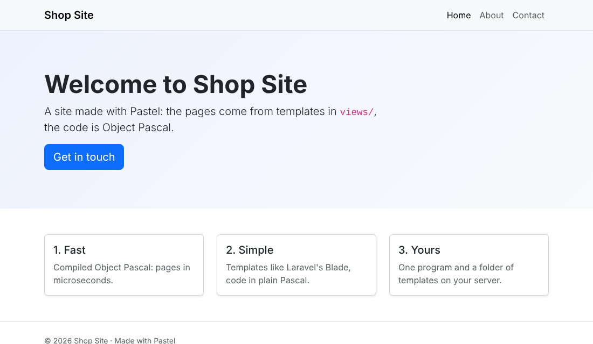

# Web pages from templates

`Pastel.Pages` makes HTML pages from templates, in the style of Laravel's Blade: a layout around every page, sections, loops and conditions, values made safe for HTML. A web site is a [web service](web.md) whose handlers answer with pages.



## A new site

```sh
pastel new site shop
cd shop
pastel run              # http://localhost:8080
pastel test
```

| | |
|---|---|
| `src/main.pas` | the service: settings and the web server |
| `src/webpages.pas` | the pages: one handler for each address |
| `views/layouts/main.html` | the frame of every page: Bootstrap, the menu, the footer |
| `views/partials/nav.html` | the menu |
| `views/home.html`, `about.html`, `contact.html` | the pages (the contact form is checked on the server) |
| `public/` | files served as they are, under `/static/`: `css/site.css`, pictures |
| `tests/webpages_test.pas` | the pages tested through real HTTP |

A saved template shows at the next reload of the page; a Pascal change needs `pastel run` again (or `pastel run --watch`). In VS Code: **New Project…** → *Server* → *Web Site*.

## A page

```pascal
uses
  Pastel.Web, Pastel.Json, Pastel.Pages;

procedure TWebPages.Products(Req: TWebRequest; Res: TWebResponse);
begin
  Res.Html(View('products', JObject([
    'title', 'Products',
    'products', FShop.List          // a TJSONArray, for example from Pastel.Db
  ])));
end;
```

`View(Name, Data)` reads `views/products.html` (`'shop.list'` is `views/shop/list.html`), fills it with the data — a JSON object, freed by `View` — and gives the HTML. Templates are read once and again when their file changes.

## Templates

### Values

```html
<h1>{{ title }}</h1>                      {{-- made safe: < > & " ' become entities --}}
<p>{{ user.name }}, {{ user.address.city }}</p>
<p>{{ products.0.name }} and {{ products.count }} more</p>
<div>{!! article.html !!}</div>            {{-- as it is: only for HTML you made yourself --}}
<script>const cart = @json(cart);</script>
```

A missing value is empty. `{{-- ... --}}` is a comment (it is not sent). `@{{ x }}` writes `{{ x }}` itself, for JavaScript frameworks.

### Conditions

```html
@if(user.admin)
  <a href="/admin">Admin</a>
@elseif(user.name)
  Hello {{ user.name }}
@else
  <a href="/login">Sign in</a>
@endif

@unless(products)
  <p>Nothing here yet.</p>
@endunless

@isset(order.paid_at)
  Paid: {{ order.paid_at }}
@endisset
```

Conditions: `==`, `!=`, `<`, `<=`, `>`, `>=`, `and` (`&&`), `or` (`||`), `not` (`!`), brackets, texts in quotes, numbers, `true`, `false`, `null`. Empty texts, `0`, `false`, `null` and empty lists count as false. `{{ paid ? 'Paid' : 'Open' }}` chooses a value.

### Loops

```html
<ul>
@foreach(products as product)
  <li class="{{ loop.first ? 'first' : '' }}">{{ loop.iteration }}. {{ product.name }}</li>
@endforeach
</ul>

@forelse(orders as order)
  <tr><td>{{ order.number }}</td><td>{{ order.total | number:2 }}</td></tr>
@empty
  <tr><td colspan="2">No orders yet.</td></tr>
@endforelse

@foreach(settings as name => value)
  {{ name }}: {{ value }}
@endforeach
```

In a loop: `loop.index` (from 0), `loop.iteration` (from 1), `loop.first`, `loop.last`, `loop.count`.

### Layouts, sections and partials

`views/layouts/main.html`:

```html
<!doctype html>
<html>
<head><title>@yield('title', 'Shop')</title></head>
<body>
  @include('partials.nav')
  <main>@yield('content')</main>
</body>
</html>
```

`views/products.html`:

```html
@extends('layouts.main')

@section('title', 'Products')

@section('content')
  <h1>{{ title }}</h1>
@endsection
```

A page fills the sections of its layout (a layout can extend another layout); text outside the sections is not shown. `@include('partials.nav')` puts another template in, with the same data. `@yield('title', 'Shop')` shows `Shop` when no page fills the section.

### Filters

```html
{{ name | upper }}               {{-- ÇAĞ; the app's language decides about i/İ: upper:'tr' --}}
{{ name | lower }}
{{ price | number:2 }}           {{-- 1,234.50 --}}
{{ phone | default:'—' }}
{{ comment | length }}           {{-- letters, not bytes --}}
{{ word | trim }}
{{ data | json }}
```

Your own: a function of a text and an argument.

```pascal
function Money(const Value, Arg: string): string;
begin
  Result := FormatFloat('#,##0.00', StrToFloatDef(Value, 0)) + ' ₺';
end;

RegisterPageFilter('money', @Money);       // {{ total | money }}
```

## A form

The site's contact page shows the pattern: on mistakes, the page again with the messages and what was typed (status 422); otherwise thanks.

```pascal
procedure TWebPages.SendMessage(Req: TWebRequest; Res: TWebResponse);
var
  D, Errors: TJSONObject;
begin
  D := JObject(['old', JObject(['name', Req.Form('name'), 'email', Req.Form('email')])]);
  Errors := TJSONObject.Create;
  if Trim(Req.Form('name')) = '' then
    Errors.Add('name', 'Please write your name.');
  D.Add('errors', Errors);
  if Errors.Count > 0 then
    Res.Html(View('contact', D), 422)
  else
    Res.Redirect('/thanks');
end;
```

```html
<input class="form-control {{ errors.name ? 'is-invalid' : '' }}" name="name" value="{{ old.name }}">
<div class="invalid-feedback">{{ errors.name }}</div>
```

## Files, folders and servers

`View` finds `views/` next to the program (on a server), in the folder it runs in (`pastel run`), or in the project when the program is in `build/`. `SetViewsFolder` sets another one; `FindAppFolder('public')` finds `public/` the same way for `Web.Static('/static', ...)`. `pastel package` puts `views/` and `public/` into the package (`[package] include` in `pastel.toml`), and `deploy/<name>.service` runs the site on a Linux server ([deploy.md](deploy.md)).

Without files: `RenderPage(Template, Data)` fills a template given as text; `TPages.Create(Folder)` gives a set of templates of your own (`Render`, `RenderText`).

## Mistakes

A mistake in a template stops the page with the file and the line: `products(12): @endforeach is missing`, `home(3): there is no filter "money"`. The web server answers with status 500 and writes the message to the log.
