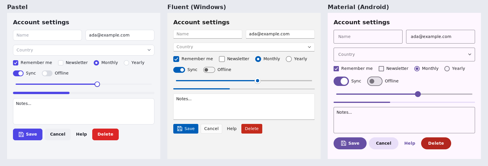

# Styles: Fluent, Material and your own

Pastel draws every control itself, so a form looks the same everywhere. A **style** changes how the controls look: their sizes, corners, borders, focus and colors. Like Delphi's FireMonkey styles, each platform has its own, and you can write your own in a style file (Delphi's `TStyleBook`).

| Style | Looks like | Buttons | Edits |
|---|---|---|---|
| `pastel` | Pastel's own look, the same everywhere | 8 px corners | a box, a soft ring when focused |
| `fluent` | Windows 11 | 32 px high, small corners, a border on secondary buttons | a line at the bottom, the accent when focused |
| `material` | Android (Material 3) | 40 px high, round ends; flat buttons are text buttons in the accent | an outline, thicker when focused |
| `auto` | the platform it runs on: Fluent on Windows, Material on Android, Pastel elsewhere | | |

The style also sets checkboxes, radio buttons, switches, sliders, progress bars, the corners of lists, popups and dialogs, and the order of a dialog's buttons (OK Cancel on Windows).



## Choosing the style

In `assets/theme.toml`:

```toml
style = "auto"
```

New apps (`pastel new app`) have this line. Without it, an app uses `pastel`, as before 2.1. `style = "fluent"` gives every platform the Windows look.

The light and dark themes stay: every style has both, and `Appearance` on the main form chooses one as before.

From code, while the app runs (the form is laid out and drawn again):

```pascal
uses Pastel.UI;

UseStyle('material');             // False: there is no such style
if UIStyle.Name = 'fluent' then ...
```

To try one without changing the files: `PASTEL_STYLE=fluent pastel run`. The designer in VS Code has a style box in its top bar, and `pastel preview` takes `--style`:

```sh
pastel preview src/forms/Home.pform -o home-android.png --style material
```

## Your colors over a style

The colors of `assets/theme.toml` are put over the style's colors, in every style:

```toml
style = "auto"
accent = "#0A7D5A"

[dark]
accent = "#5EE0B0"
```

Names: `accent`, `on_accent`, `background`, `surface`, `text`, `text_muted`, `placeholder`, `secondary`, `border`, `outline` (the border of edits in Fluent and Material), `danger`, `disabled`, `tooltip_back`, `tooltip_text`, `radius`, `font_size`. Hover and pressed shades follow the color.

## A style file

A style of your own is a TOML file in `assets/styles/`; its file name is its name. It starts from a `base` style and changes what it says:

```toml
# assets/styles/company.pstyle
base = "material"          # pastel, fluent, material, or another style file
radius = 6                 # cards, lists, grids

[colors]                   # as in theme.toml
accent = "#0A7D5A"
[colors.dark]
accent = "#5EE0B0"

[button]
padding_x = 32             # the room left and right of the text, together
padding_y = 16             # above and below, together
radius = 6                 # 999: round ends
border = 0                 # a border on secondary buttons
bold = true

[field]                    # edits, memos, combo boxes, date pickers
look = "box"               # box, underline (Fluent) or outline (Material)
radius = 6
padding_x = 12
padding_y = 20
```

Use it in `assets/theme.toml` with `style = "company"`. The designer and `pastel preview` find the project's style files too.

| Section | Values |
|---|---|
| (top) | `base`, `radius` |
| `[colors]`, `[colors.dark]` | the theme's colors, as in `theme.toml` |
| `[button]` | `padding_x`, `padding_y`, `radius`, `border`, `bold` |
| `[flat_button]` | `padding_x`, `padding_y`, `accent` (text in the accent color), `overlay` (hover shades what is under it) |
| `[field]` | `look` (`box`, `underline`, `outline`), `radius`, `padding_x`, `padding_y` |
| `[check]` | `size`, `radius` (checkboxes and radio buttons) |
| `[switch]` | `look` (`pill`, `fluent`, `material`; sliders and radio buttons follow it too) |
| `[slider]` | `thumb` (the knob's radius) |
| `[progress]` | `height` |
| `[popup]`, `[dialog]` | `radius`; `[dialog]` also `default_first` (OK Cancel) and `flat_buttons` |
| `[focus]` | `look`: `ring` (a soft ring of the accent) or `outline` (a line in the text color, when the keyboard moves the focus) |

A mistake is said when the app starts (on the console) and by `pastel check`, with the line: `button.height = 40: "button.height" is not a style value`.

## Looks: StyleLookup

A style file can have named looks, and a control uses one with `StyleLookup` (as in FireMonkey):

```toml
[look.BigGreen]
color = "#16A34A"
hover_color = "#15803D"     # without it: a little darker
pressed_color = "#166534"
text_color = "#FFFFFF"
padding_y = 30
radius = 12

[look.BigGreen.dark]        # only what changes in the dark theme
color = "#22C55E"

[look.Warning]
text_color = "#B45309"
font_size = 16
bold = true
```

```
object PayButton: TButton
  Text = 'Pay now'
  StyleLookup = 'BigGreen'
end
object Note: TLabel
  Text = 'The offer ends today'
  StyleLookup = 'Warning'
end
```

| Control | What a look changes |
|---|---|
| `TButton` | `color`, `hover_color`, `pressed_color`, `text_color`, `border_color`, `border_width`, `radius`, `padding_x`, `padding_y`, `font_size`, `bold` |
| `TLabel` | `text_color`, `font_size`, `bold` (when the label does not set them itself) |
| `TColumn`, `TRow`, `TPanel`, `TCard`... | `color`, `border_color`, `border_width`, `radius` (when the box does not set them itself) |
| `TEdit`, `TMemo`, `TComboBox`, `TDatePicker` | `color`, `border_color`, `border_width`, `radius`, `padding_x`, `font_size` |

A look belongs to a style: when the app uses another style, `StyleLookup` finds nothing there and the control looks as the style says. A style made on another (`base = "company"`) has its looks. `pastel check` warns about a `StyleLookup` that no style file in `assets/styles/` has.

## Your own controls in the style

A control of your own reads the style to fit in:

```pascal
procedure TStarRating.Paint(C: TCanvas32);
begin
  C.FillRoundRect(Bounds.X, Bounds.Y, Bounds.W, Bounds.H, StyleRadius(UIStyle.ButtonRadius), Theme.Surface);
  if IsFocused then
    DrawFocus(C, Self, Bounds, Theme.Radius);     // a ring or an outline, as the style draws it
  ...
end;
```

`PaintField` draws the box of an edit in the style, and `FieldHeight(LineHeight)` gives its height. See [Writing components](components.md).
