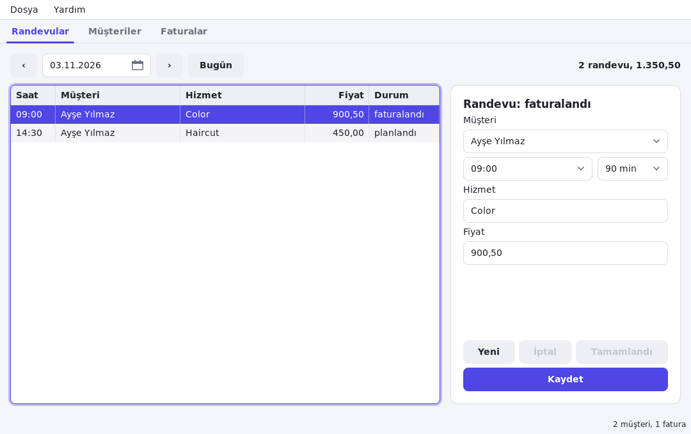

# salon-desk

The desktop app of the salon system: the computer at the reception of a hair salon (or a clinic, a repair shop...). It uses [salon-core](../salon-core) for the data and [components](../components) for the date picker and the price field.



| Page | |
|---|---|
| **Appointments** | One day (‹ › Today, or the date picker): the appointments with time, customer, service, price and status; a form to add or change one; *Done* and *Cancel* |
| **Customers** | Search, the list, and the customer's details (a `TDataBinding`) |
| **Invoices** | Invoices of the done appointments of a customer, with VAT; *Mark as paid* |

The data is a SQLite file in the user's settings folder (`SALON_DB=file.db` for another one), so the app works without a network. **File > Sync** (Ctrl+R) exchanges the changes with the server ([salon-api](../salon-api)); its address and API key are in **File > Settings**. The app is in English and Turkish (`assets/lang/tr.json`; `PASTEL_LANG=tr` to try it).

```sh
pastel run
pastel package installer --target windows    # for the shop's Windows computer
```

The tests drive the app without a screen:

```sh
SALON_DB=/tmp/test.db PASTEL_HEADLESS=1 PASTEL_TEST_SCRIPT=tests/ui.txt ./build/linux/debug/salon-desk
```

`tests/sync.txt` and `tests/sync-2.txt` are two computers syncing through a running salon-api (see `tests/run.sh`). How the whole system is built: [docs/guide-business.md](../../docs/guide-business.md).
